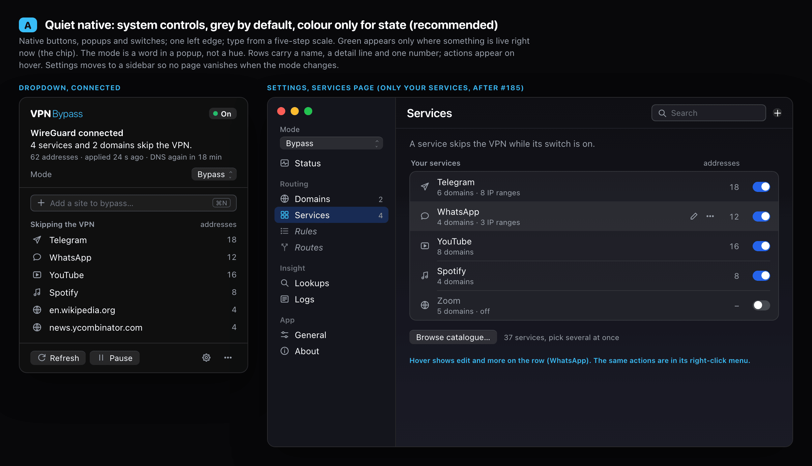
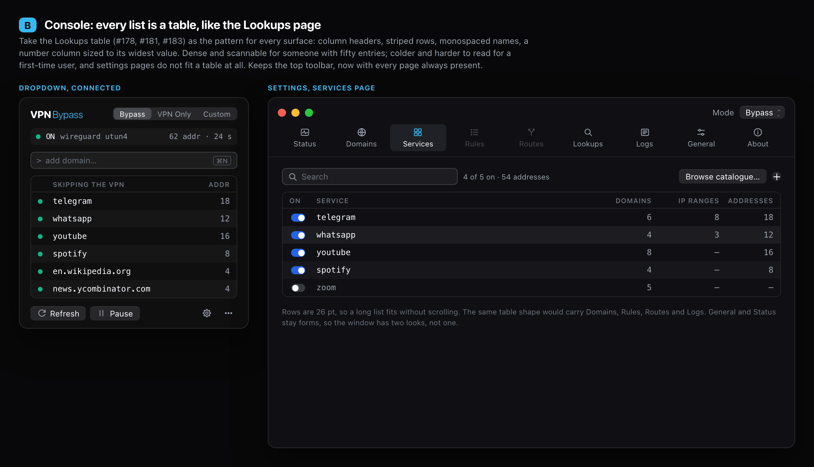
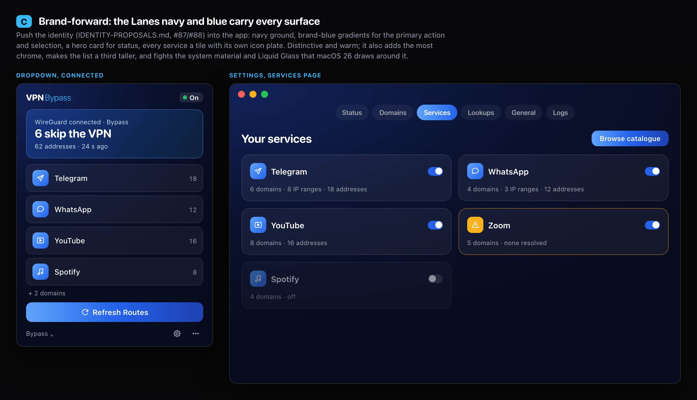
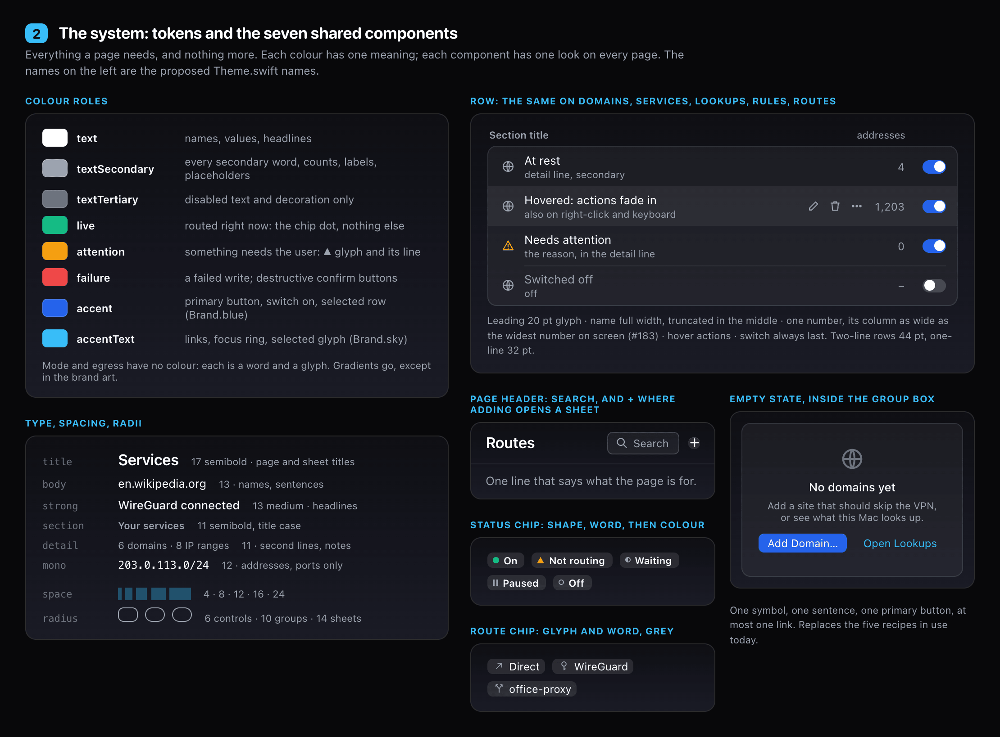
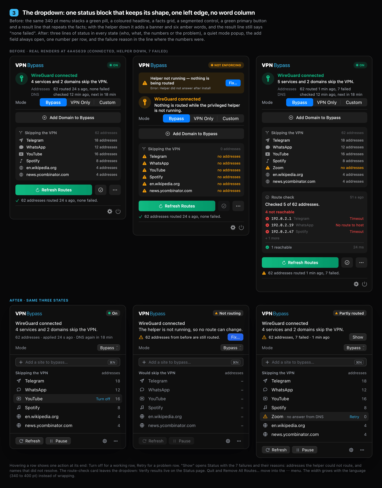
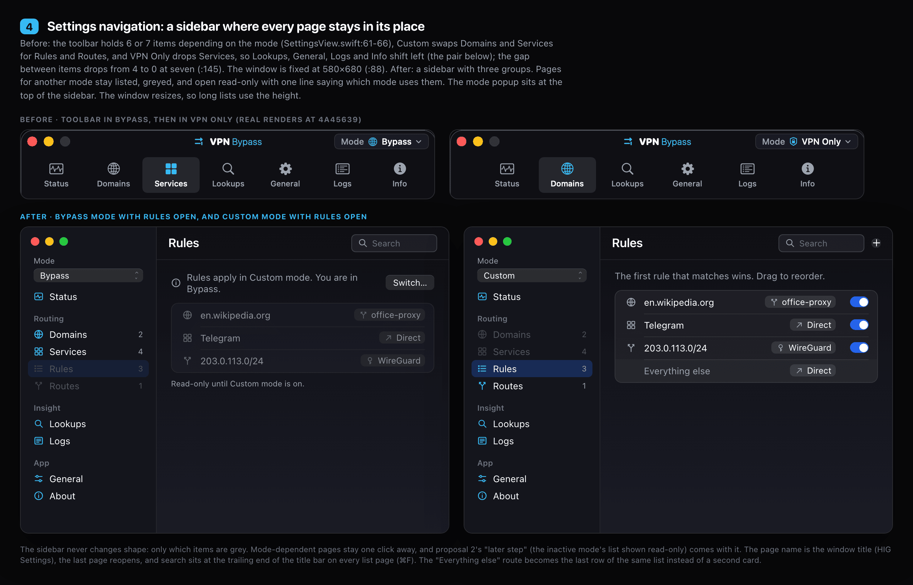
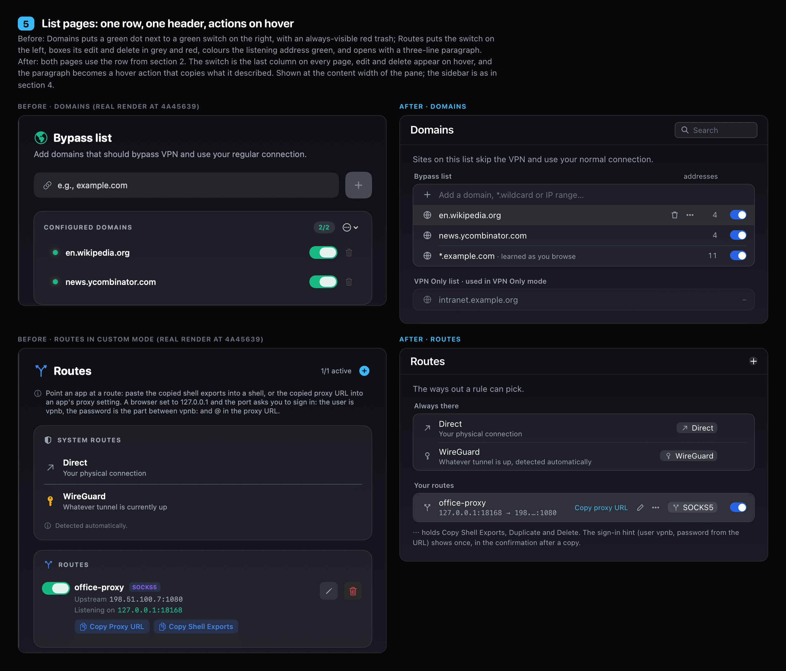
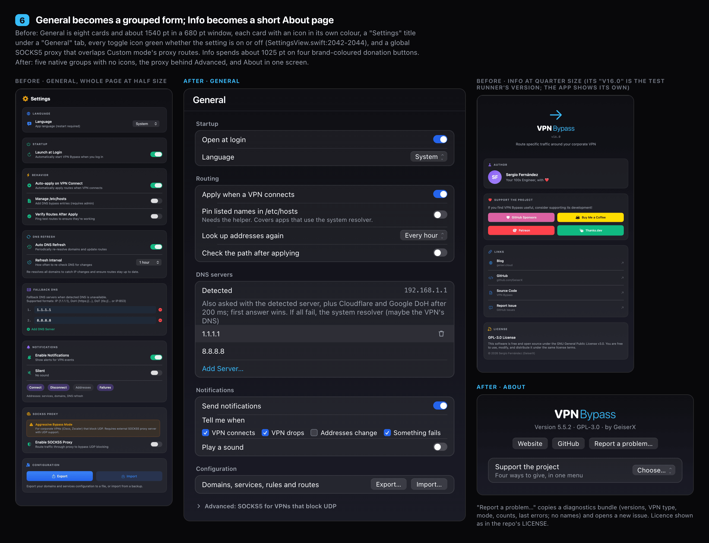
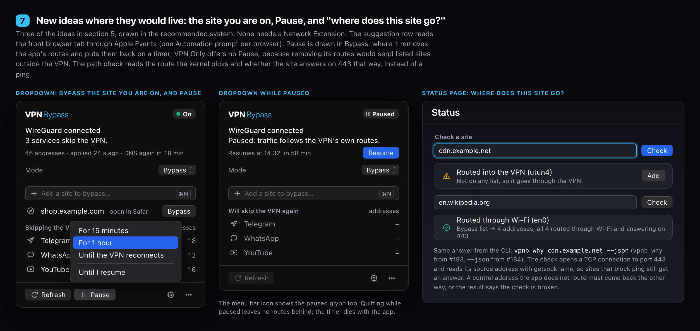

# App rework proposals: one visual system for the whole app, and what to build next

## Decided

We picked on 2026-10-30. All of it ships in 6.0.0, in the order of section 6.

- **Direction: 2A, quiet native** (section 2).
- **Settings: the sidebar, 3.2 B.**
- **Global SOCKS5 proxy: 3.5 A.** It moves behind an Advanced disclosure and is hidden in Custom mode.
- **Every bug in section 4:** A1 to A7 and B1 to B4.
- **Every flow fix in section 4:** 1 to 8.
- **Every new idea in section 5:** 1 to 12. Idea 8, the kill-switch warning, already shipped in [#189](https://github.com/GeiserX/VPN-Bypass/pull/189). Ideas the table marks Later, Maybe or After #185 are built too, as step 15 of section 6.
- **Already on `release/6.0`:** `vpnb --json` from #184 ([#187](https://github.com/GeiserX/VPN-Bypass/pull/187)), the #185 service catalogue ([#190](https://github.com/GeiserX/VPN-Bypass/pull/190)), and the engine and CLI of ideas 1 and 2, the path check and `vpnb why` ([#193](https://github.com/GeiserX/VPN-Bypass/pull/193)). Step 13 still adds the Status page field for idea 2, and step 7 builds on the merged catalogue.

The rest of this doc is the proposal those picks came from. The first round, [`UI-UX-PROPOSALS.md`](UI-UX-PROPOSALS.md), fixed sixteen problems one at a time and shipped as 5.0.0. This round looks at the whole app at once: the menu bar dropdown, the Settings window and every page in it.

Every claim about the current app points at the code as of `main` at [`4a45639`](https://github.com/GeiserX/VPN-Bypass/commit/4a45639) (5.5.2). The "before" halves of the images are crops of real renders of the app at that commit, drawn offscreen with the app's own views and placeholder data (WireGuard, `192.0.2.x`, `198.51.100.x`, `example.com`). Copies are kept in [`proposals/rework/before/`](proposals/rework/before/), so a re-render gives the same crops. One artefact of rendering inside the test runner: the Info crop shows "v16.0", the runner's own version, where the app shows its release number. The "after" halves are HTML mockups in [`proposals/rework/`](proposals/rework/). Their colours come from [`Theme.swift`](../../Sources/VPNBypassCore/Theme.swift), and the proposed tokens are written out in [`rework.css`](proposals/rework/rework.css). Re-render with [`proposals/rework/render.sh`](proposals/rework/render.sh), then run `pngquant --quality 80-95` over each PNG.

Sizes as in the first round. S is an afternoon and one or two files. M is a day or two, or some new state in `RouteManager`. L is a redesign of a whole surface.

Two lanes are in flight, and everything here builds on them. The first is [#184](https://github.com/GeiserX/VPN-Bypass/issues/184): `vpnb --json` and a doc on routing priority. The second is [#185](https://github.com/GeiserX/VPN-Bypass/issues/185), the service catalogue: built-in services become bundled JSON, the Services page shows only the user's own services, a "Browse catalogue…" sheet picks several at once, and the first-run dropdown takes its common services from the catalogue. The logo and the Lanes palette ([`IDENTITY-PROPOSALS.md`](IDENTITY-PROPOSALS.md)) stay as they are.

## 1. Where the app stands

The app works, and the first round made it honest about what it is doing. But it grew through about 180 PRs, and each page was polished on its own terms. The Lookups page ([#178](https://github.com/GeiserX/VPN-Bypass/pull/178), [#181](https://github.com/GeiserX/VPN-Bypass/pull/181), [#183](https://github.com/GeiserX/VPN-Bypass/pull/183)) shows the target look: quiet rows, actions on hover, names that take the full width, and a number column that sizes to the widest number on screen. That look exists on one page only. Elsewhere the same job is drawn eleven ways. Five root problems sit behind most of the symptoms in the audits:

1. **There is no shared vocabulary.** `Theme.swift` holds colours only (`Theme.swift:9-111`): no type scale, no spacing, no radii, no components. Across the Settings views there are 16 font sizes, 9 corner radii, 7 header layouts, 11 row layouts, 4 ways to draw delete, 7 ways to draw add, and 5 empty-state recipes. Each page picks its own.
2. **Colour has too many meanings, so it no longer says anything.** Green (`Theme.success`) is used 47 times for about fifteen jobs: a switch that is on, a dot that repeats the switch (`SettingsView.swift:539-544`), the identity of Bypass mode, the primary button in the dropdown (`MenuBarViews.swift:256-260`, `:479`), a spinner, the Thanks.dev button, and every toggle icon on General whether that setting is on or off (`SettingsView.swift:2042-2044`). Orange means "warning", and it also means VPN Only mode and all three Rules match pills (`RulesTab.swift:876-879`). A user cannot read state from colour, which is the one thing colour should do.
3. **The dropdown works out its state in several places, and they disagree.** The pill, the headline, the facts, the helper banner and the result line under Refresh each read different inputs. With the helper down, the banner says nothing is routed and the result line still says "62 addresses routed 24 s ago, none failed" (`shownRouteChange`, `MenuBarViews.swift:870`). At startup the header says "connected" over a spinner (`DropdownStatus.make`, `:1483`, never reads `isLoading`). The pill stays a green ON over 1,203 failures (`:1570`).
4. **The frames were sized for a smaller app.** The dropdown is fixed at 340 pt (`MenuBarViews.swift:309`), so Spanish and French wrap and stack. The Settings window is fixed at 580×680 and cannot be resized (`SettingsView.swift:88`), while General is about 1540 pt tall. The toolbar's page set changes with the mode (`SettingsView.swift:61-66`): Custom swaps Domains and Services for Rules and Routes, and VPN Only drops Services, so Lookups, General, Logs and Info shift left.
5. **Every action beyond Refresh lives in Settings.** From the dropdown you cannot pause, act on a row, see which addresses failed, add while disconnected, or remove routes that were kept for a reconnect.

The proposals below mostly remove things. They take away a colour from about thirty places, two cards, a banner, a result line, a segmented control, a power button, a toolbar that changes shape, and 1,000 pt of General and Info. They add seven shared components in their place.

## 2. The visual system

### Three directions, compared on the same two screens

Each image shows the dropdown while connected and the Services page as it will look after #185 (only the user's services, with "Browse catalogue…"). The data is the same in all three.

#### 2A. Quiet native (decided)

Native buttons, popups, switches and search fields, drawn grey. Colour appears only for state. The mode is a word in a popup. Rows have a name, a detail line, one number and a trailing switch. Actions appear on hover, and the same actions are in the right-click menu. Settings moves to a sidebar.

**Trade-off.** It is the plainest of the three, and the least branded inside the window: the brand lives in the wordmark, the icon and the accent blue. It costs the least to keep consistent, because most of it is system controls that macOS keeps current, Liquid Glass included. It matches what the owner already chose on Lookups.

#### 2B. Console

Every list becomes a table like Lookups: column headers, striped rows, monospaced names, 26 pt rows.

**Trade-off.** Dense and quick to scan with fifty entries. But it reads as a tool for experts in an app whose most common user arrives without knowing what to add (#176). Monospace makes long names harder to read. And General, Status and the sheets do not fit a table, so the window would end up with two looks.

#### 2C. Brand-forward

The Lanes navy and blue on every surface: a hero card for status, gradient primary buttons, every service a tile with a coloured icon plate.

**Trade-off.** Distinctive. It also adds the most chrome, makes lists about a third taller, and puts a custom ground under macOS 26's own materials. HIG asks for Liquid Glass to stay out of the content layer and for colour to keep one meaning ([colour](https://developer.apple.com/design/human-interface-guidelines/color), [materials](https://developer.apple.com/design/human-interface-guidelines/materials)). It is also the opposite of "prefer removals".

**Recommendation: 2A (decided).** It is the only direction that removes more than it adds, it is the look the owner already picked on Lookups, and it follows the platform rather than competing with it. The rest of this doc is drawn in 2A.

### The system, as tokens and components

**Colour roles.** Each colour has one job. The names are proposed `Theme` names, and the hex values are the ones in `Theme.swift` today. No new colour is added.

| Role | Value | Used for | Replaces |
|---|---|---|---|
| `text` | `#FFFFFF` (`textPrimary`) | names, values, headlines | |
| `textSecondary` | `#9CA3AF` | every secondary word, counts, labels | `textTertiary` wherever it carries information (`Theme.swift:11` says tertiary is decorative only; the dropdown uses it for fact labels and counts) |
| `textTertiary` | `#6B7280` | placeholders and disabled text only | |
| `live` | `#10B981` (`success`) | something is routed right now: the status chip dot, a passed path check | every other green use: switches, dots, buttons, gradients, icons, links, spinners, mode identity, the Tailscale egress colour |
| `attention` | `#F59E0B` (`warning`) | the user needs to look: ▲ glyph and its line | VPN Only identity, match-type pills, VPN egress colour, General card icons |
| `failure` | `#EF4444` (`error`) | a write that failed; destructive confirm buttons | "No VPN connected" (an ordinary state, today red: `MenuBarViews.swift:1503`), always-red trash icons, the Patreon button |
| `accent` | `#2563EB` (`Brand.blue`) | the one primary button, switches when on, the selected sidebar row | `accentGradient` (green), `blueGradient`, `purpleGradient`, system-blue segmented controls, the blue HTTP and purple SOCKS5 egress colours (`RulesTab.swift:30-31`) |
| `accentText` | `#38BDF8` (`Brand.sky`) | links, focus ring, selected glyph | |

The mode gets no colour, and neither does the egress: each is a word and an SF Symbol. Today `Route.accentColor` gives each egress a hue (`RulesTab.swift:28-35`: grey Direct, `Theme.blue` HTTP, `Theme.purple` SOCKS5, green Tailscale, orange VPN), and those hues go. A per-egress hue would sit next to the blue of a switch that is on, or the green of live state, on the same row: a light blue VPN dot beside a blue switch reads as "on", not "VPN". The route chip says where traffic goes with a glyph and a word instead (↗ Direct, a key and the VPN's name, a branch and the proxy's name). All five gradients go (`Theme.swift:30-60`), and so do `bgInputAlt` (`:69`), the inline `Color(hex:)` calls (7 in `MenuBarViews.swift`, 1 in `SettingsView.swift`) and the raw whites in `SettingsUndo.swift:217-231`. The fundraising colours (`Theme.swift:82-84`) leave the UI too (see 3.5).

**Type.** Five steps and one monospaced style, added to `Theme` as `Theme.Font`:

| Token | Spec | Used for |
|---|---|---|
| `title` | 17 semibold | page title, sheet title |
| `body` / `strong` | 13 regular / 13 medium | names, sentences / headlines |
| `section` | 11 semibold, title case | section labels above a group |
| `detail` | 11 regular, secondary | second lines, notes, counts |
| `mono` | 12 monospaced | IP addresses, ports, CIDR only (not domain names) |

Numbers use `monospacedDigit()` so columns line up. `design: .rounded` stays in the wordmark only. The uppercase tracked labels (`SettingsView.swift:2008-2012`, `:363`, `LookupsTab.swift:185-189`) become `section`.

**Spacing and radii.** Spacing comes in 4, 8, 12 and 16 pt, plus 24 for page margins (`Theme.Space`). Rows are 32 pt with one line and 44 pt with two, inset 12 pt, with a 20 pt leading glyph column. Radii are 6 for controls, 10 for group boxes and 14 for sheets (`Theme.Radius`). That replaces 9 radii and about 40 padding values.

**Seven shared components.** Each is one SwiftUI view, used by every page that needs it:

1. **`GroupBox` section.** A `section` label above a box (white 5%, 0.5 pt border, radius 10). Rows inside are divided by an inset hairline. It replaces `SettingsCard`, the hand-built Domains card (`SettingsView.swift:404-412`), the Services list box (`:882-885`), the Lookups table box and the Status section box, which today use four recipes. The Status page's `StatusSection` is the closest to this today and becomes the model.
2. **`ListRow`.** A leading glyph (or ▲ when the row needs attention), then the name, full width and truncated in the middle. An optional detail line goes under the name. Then hover actions, one number in a column as wide as the widest number on screen (the #183 rule, moved out of `LookupRow.countColumnWidth`, `LookupsTab.swift:259`), and the switch, always last. A problem is said in the detail line, never in a column of words on the right.
3. **`PageHeader`.** The page name is the title in the window's title bar. Search goes at the trailing end (⌘F). Pages that add through a sheet (Services, Rules, Routes) put one add button (+) beside it; Domains adds through an inline field instead (3.3), so its header has no +. Under the title, one secondary line says what the page is for.
4. **`EmptyState`.** Inside the group box: a 26 pt symbol, one sentence, one primary button and at most one link. It replaces the five recipes listed in the Settings audit (Domains `:422-436`, Rules `RulesTab.swift:615-646`, Routes `RoutesTab.swift:161-191`, Logs `SettingsView.swift:2082-2094`, Lookups `LookupsTab.swift:137`).
5. **`StatusChip`.** A shape, then a word, then a colour: ● On, ▲ Not routing or Partly routed, ◐ Waiting, ॥ Paused, ○ Off.
6. **`RouteChip`.** A grey glyph and the route's name, the same label on Rules and Routes (the detected VPN shows its name, as `Route.friendlyName` does today, `RulesTab.swift:12-20`). It is a menu's label with our own chevron and the system indicator hidden, which fixes the double chevron in 3.3.
7. **`SheetScaffold`.** The one sheet frame, described in 3.6.

**Hover actions.** A row shows its actions (edit, delete, ⋯) when the pointer is over it, and fades them out after. Every hover action is also in the row's right-click menu and reachable from the keyboard: Return edits, ⌘⌫ deletes, and Space toggles the switch. Hover alone would hide them from trackpad users who never hover and from keyboard users.

**Where it lives.** `Theme.swift` grows from colours to tokens: `Theme.Font`, `Theme.Space`, `Theme.Radius`, and the colour roles renamed above, keeping the old names as deprecated aliases for one release. The seven components go in a new `Components.swift`. Nothing on any page changes in that PR. Each page then moves over in its own PR (section 6).

**Size.** M for tokens and components. Each page after that is S or M.

## 3. Each surface under the system

### 3.1 The dropdown

**What the user sees.** A green ON pill, a key icon in a 36 pt disc, a green headline, a facts grid, a segmented Mode control, a green Refresh Routes button, a Verify button and a ⋯ button, a result line, then a gear and a power button. With the helper down there are four signals on top of each other: a banner, a NOT ENFORCING pill, an amber headline, and six amber "no addresses" words. The result line underneath still says "none failed". With failures, a route-check card adds a red column of reasons.

**Where.** `MenuContent` in `MenuBarViews.swift:262-330`. `DropdownStatus.make` at `:1483-1575` decides the pill and the headline. `StatusHeader` with its 36 pt icon is at `:1345-1389`. The mode row and its stacked fallback for es and fr are at `:1283-1325`. The helper banner is at `:358-383`, the quick add at `:395-420` and `:760-780`, the actions at `:470-530`, the result line at `:860-880`, the card rows with their right column at `:2008-2028`, `RouteCheckCard` at `:2067`, and `footerActions` at `:728`, with the icon buttons in `ControlNames.swift:85-91`.

**What it costs.** The user has to read four places to learn one thing, and two of them can contradict each other. The block above the list changes height from state to state (2, 4 or 5 lines, plus the banner), so the list jumps. Refresh is the brightest thing on screen, yet it is an action and not a state. The fixed width breaks Spanish and French.

**Proposal.**

- **One status block, always three lines, at one left edge.** Line 1 says who is connected. Line 2 says what is routed. Line 3 holds the numbers when all is well, or the one problem with its one button: "Fix…", "Show", or "Resume". No icon disc. The chip on the right of the wordmark is the only coloured signal, and the menu bar icon uses the same state (it already switches between three template images, `MenuBarViews.swift:14-31`; Paused and Partly routed would be added).
- **One source of truth.** `DropdownStatus` becomes the only thing that decides the chip, the sentence and line 3, and it reads helper state, `isLoading`, failures and problem rows. The banner and the result line are removed. That also removes bugs A2 to A4 in section 4. With the helper down it never says "nothing is routed": routes added before stay in the kernel, so line 3 says how many are still in place.
- **Mode as a popup** on its own quiet row. A popup that opens the existing confirm sheet is ordinary macOS behaviour (2B in the first round). The segmented control goes, and so does the es/fr stacked fallback.
- **The add field is always open**, with ⌘N to focus it and Esc to cancel. Its placeholder follows the mode: "Add a site to bypass…", "Add a site for the VPN…", and in Custom "Add a Direct rule…".
- **List rows** show a glyph, a name and one number. The word "addresses" appears once, above the column. A problem row gets the ▲ glyph and its reason after the name. On hover a row offers one action at its end: Turn off for a working row, Retry for a problem row. The list scrolls past 8 rows instead of showing "+ 5 more" as plain text (`:2026`).
- **Footer.** Refresh and Pause as plain bordered buttons, then Settings and ⋯. Quit, Verify, Re-resolve DNS and Remove All Routes… go in ⋯, which stops repeating the visible buttons (`:513-529`). The power button goes.
- **The route-check card leaves the dropdown.** "Show" opens Status, where the failed addresses and their reasons are listed (3.4).
- **Disconnected** keeps the same block: chip ○ Off, grey not red. "No VPN connected." The list stays visible as "Kept for when it reconnects", with Remove… in ⋯. That replaces the 36 pt `wifi.slash` empty state and its green stat badges (`:624-665`).
- **Width** grows with the language between 340 and 400 pt instead of wrapping.

**Size.** L. `MenuBarViews.swift` is rebuilt around the components, and `RouteManager` publishes the per-row failure reason (it already logs it).

### 3.2 Settings navigation: toolbar or sidebar

**What the user sees.** A row of icon-above-label toolbar items. In Bypass it holds Status, Domains, Services, Lookups, General, Logs and Info. In Custom, Domains and Services become Rules and Routes in the same two slots. In VPN Only, Services disappears, so Lookups, General, Logs and Info each shift one slot left. The window cannot be resized.

**Where.** `tabs(for:)` at `SettingsView.swift:61-66`, the toolbar at `:143-191` (the gap drops from 4 to 0 at seven items, `:145`), the frame at `:88` and `:2627-2628`, and the Mode pill in the title bar at `RoutingModeSwitcher.swift:194-227`.

**What it costs.** A user who changes mode can lose the page they were on, and in VPN Only every page after Domains moves. The other mode's list can only be reached by switching the whole Mac's routing. Long pages scroll inside a short, fixed box, and two of them nest a second scroll view inside the page's own (`SettingsView.swift:843` and `:2120`, inside `:171`).

**Proposal.** Three options; B is decided:

- **(A) Keep the toolbar, show every page in every mode.** The cheapest. But nine items do not fit at 580 pt, so the window gets wider and the toolbar is still a flat row with no grouping.
- **(B) A sidebar (decided).** Status at the top, then three groups. Routing holds Domains, Services, Rules and Routes. Insight holds Lookups and Logs. App holds General and About. The mode popup sits at the top of the sidebar. Pages for another mode stay listed, greyed, and open read-only with one line: "Rules apply in Custom mode. You are in Bypass. [Switch…]". The window gets a minimum size of about 720×480 and can grow. The last page reopens and the page name is the window title. Search is in the title bar on every list page. `NavigationSplitView` is available on macOS 13, which is the app's target (`Package.swift:8`).
- **(C) A main window and a separate small Settings window**, the way the Tailscale app went. It is the most flexible but means two windows to explain, for an app that has one job.

**Recommendation: B (decided).** The sidebar never changes shape, because a mode change only greys different items. It also delivers the unbuilt "later step" from the first round's proposal 2 (`UI-UX-PROPOSALS.md:43`): the inactive mode's list shown read-only. The nested scroll views go, because the page itself scrolls.

**Size.** M. `SettingsView.swift`'s shell and `RoutingModeSwitcher.swift`. The pages themselves move in their own PRs.

### 3.3 List pages: Domains, Services, Lookups, Rules, Routes

**What the user sees.** Domains and Services put the switch on the right, Rules and Routes on the left (`RulesTab.swift:857-865`, `RoutesTab.swift:405-412`). Domains shows a green dot next to a green switch, and an always-visible red trash (`SettingsView.swift:539-544`, `:586`). Routes boxes its edit and delete buttons in grey and red and shows them all the time (`RoutesTab.swift:440-458`). It colours the listening address green (`:495`) and opens with a three-line paragraph on how to sign in to the proxy (`:88-97`). On Rules, the route menu renders as "⌄ office-proxy ⌄" in plain white, losing its colour (`RulesTab.swift:956-961`, `:993-1008`). The arrow after the pattern points into 300 pt of empty space (`:885-889`).

**What it costs.** Each page has to be learned again, and the switch columns do not line up across pages. The always-visible red buttons invite misclicks next to the switches. Green text on Routes is the column-of-status pattern the owner has already rejected on Lookups (#181).

**Proposal.** Every list uses `ListRow` and `PageHeader`.

- **Domains.** The add field becomes the first row of the list, and it replaces the header's + on this page. The active mode's list comes first. The other mode's list follows, read-only, under "VPN Only list · used in VPN Only mode". A wildcard row says "learned as you browse" and its count is the routes it has learned. The green pill "2/2" and the uppercase header go.
- **Services.** After #185 only the user's services are listed, with "Browse catalogue…" under the list. The "ON 4" and "BUILT-IN SERVICES 33" sections go with the catalogue. The custom search field (`SettingsView.swift:776-812`) is replaced by the title-bar search. The dead VPN Only banner (`:746-775`) is removed (bug B3).
- **Lookups.** Already the model. Three changes: the section header goes to title case, the search moves to the title bar, and the main switch leaves the header (`LookupsTab.swift:58-70`). When Lookups is off, the empty state's button is "Start Watching". When it is on, a "Stop" button sits in the title bar.
- **Rules.** The route chip becomes a `Menu` with our label and `.menuIndicator(.hidden)`, so it shows one chevron and keeps its egress dot. The arrow goes, and the chip sits in the value column. The proxy explanation under a rule (`RulesTab.swift:838-843`) shrinks to the detail line ("Only apps set to use office-proxy"). The two explanations of ordering become one subtitle line. "Everything else" becomes the last row of the same list instead of a second card (shown in 3.2).
- **Routes.** Direct and the detected VPN become rows under "Always there", with the same route chip label they get on Rules. The user's routes show the listening and upstream addresses in one mono detail line. "Copy proxy URL" is the row's hover action, and ⋯ holds Copy Shell Exports, Duplicate and Delete. The sign-in hint shows once, in the confirmation after a copy, instead of as page chrome.

**Size.** S for Lookups. M each for Domains, Services (after #185), Rules and Routes.

### 3.4 Status and Logs

No image. Both keep their content and take the shared components.

**Status** (`StatusTab.swift`) is already the calmest page. Three changes:

- The real blocker goes first: with the helper failed, the summary says so and the helper section comes first, instead of "No VPN connected" over a red box lower down (`win-status-trouble`, `StatusTab.swift:411`).
- It becomes where "Show" lands from the dropdown. A Problems section lists the failed addresses, their entry, and the reason the helper returned. Verify's results move here from the dropdown card, and can be dismissed.
- The Tunnels section's blue link-styled "Refresh" becomes a plain button.

**Logs** gets a page header and the title-bar search. Copy and Clear move to the title bar. The second scroll view inside the page goes (`SettingsView.swift:2120`).

**Size.** S each.

### 3.5 General and About

**What the user sees.** General is eight cards and about 1540 pt tall. The window is 680 pt. Each card has an icon in a different colour that means nothing. The page is titled "Settings" under a toolbar item called "General" (`SettingsView.swift:1376`). Every toggle row has a green icon whether it is on or off. The Language card says "Language" twice (`:1383`, `:1391`). Notification kinds are chips whose only on/off cue is a purple fill (`:1975-1994`). A global "Aggressive Bypass Mode" SOCKS5 proxy (`:1688-1852`) sits next to Custom mode's own per-rule proxy routes, and it is still shown in Custom mode. Info is about 1025 pt, led by four brand-coloured donation buttons (`:2302-2342`), two of them red and green.

**Proposal.**

- **General as five native groups with no icons:** Startup, Routing, DNS outside the VPN, Notifications, Configuration. Notification kinds become checkboxes. "Auto DNS Refresh" and "Refresh Interval" merge into one popup, "Look up addresses again: Every hour / … / Never". "Verify Routes After Apply" becomes "Check the path after applying", which runs idea 1 in section 5 instead of ping.
- **The global SOCKS5 proxy.** Two options; A is decided:
  - **(A) Move it behind an Advanced disclosure and hide it in Custom mode (decided).** One sentence points Custom users to Routes. Nothing changes for people who use it.
  - **(B) Retire it in favour of Custom mode's SOCKS5 routes.** Simpler in the long run, but it breaks the setup of anyone using it in Bypass mode. That needs a migration and a release note.
- **About replaces Info**: wordmark, version, licence, author, three buttons (Website, GitHub, Report a problem…), and one "Support the project" row with a popup holding the four ways to give. "Report a problem…" copies a diagnostics bundle (versions, VPN type, mode, counts, recent errors, no names) and opens a new issue. That is item 15 of the August improvement plan, which was never built.

**Size.** M for General, S for About.

### 3.6 Sheets

No image. There are six sheets with three header styles, three footer layouts and three primary colours: purple on the service editor (`SettingsView.swift:1312`), a blue gradient on rule, route and mode, and system accent on new service (`LookupsTab.swift:507-513`). Widths vary from 380 to 440 pt, and the service editor's fixed 480 pt height leaves a blank band (`SettingsView.swift:1320`).

**Proposal.** One `SheetScaffold`: a title in `title`, no close button (Esc cancels), content, then Cancel and a default button on the right with no divider, as in native macOS sheets. Width 420, height fits the content. The primary button uses `accent` in every sheet. Destructive confirms use `failure`.

**Size.** S.

## 4. UX flow fixes, ranked by what they cost the user

### Fix first

These are bugs. Each is S, and none depends on the rework.

| # | Bug | Where | Fix |
|---|---|---|---|
| A1 | French translates the product name: the wordmark reads "VPN Contournement", in the dropdown and in Settings. | `Text("Bypass")` in `BrandedAppName`, `MenuBarViews.swift:178`; `fr.lproj` maps "Bypass" to the mode name | `Text(verbatim: "Bypass")` |
| A2 | Under "Helper not running, nothing is being routed", the result line says "62 addresses routed 24 s ago, none failed." | `shownRouteChange`, `MenuBarViews.swift:870` hides only `.removedAll` | Hide the line when the helper is not ready or the live count disagrees, and say how many routes are still in place, since a stopped helper leaves them in the kernel (removed for good by 3.1) |
| A3 | At startup the header says "WireGuard connected" and "NOTHING ROUTED" over the "Setting Up…" spinner. | `DropdownStatus.make`, `:1483`, never reads `isLoading`; spinner at `:603-620` | Add a Starting state to `DropdownStatus` |
| A4 | The pill stays a green ON with 1,203 failed, with a service at zero addresses, and with 4 of 5 checked addresses unreachable. | `:1570` ignores `failedCount`, problem rows and the last check | Partly routed (▲) when any of the three is true |
| A5 | In Custom the button says "Add Domain to Bypass", but it appends a Direct rule. The rule goes last, where an earlier rule can shadow it, and the field closes without saying anything. | `:404` checks only `.vpnOnly`; `addForCurrentMode`, `RulesTab.swift:136`; `:771-775` returns nil | Label "Add a Direct rule…", and confirm with the rule's position ("Added as rule 4; rule 2 matches first") |
| A6 | Disconnected, the sentence says "Connect to a VPN to start bypassing traffic for configured services" in every mode, VPN Only included. In Custom the badges count Bypass services and domains, which Custom does not use. | `:634`; badges `:641-652` | Say it per mode, and count rules in Custom |
| A7 | Routes kept while disconnected cannot be seen or removed from the dropdown, nor can routes whose removal failed. | `disconnectedContent`, `:624` has no list and no ⋯ | Keep the list and ⋯ when disconnected (3.1) |
| B1 | The Rules route menu shows two chevrons and loses its colour. | `.menuStyle(.borderlessButton)`, `RulesTab.swift:960` | `.menuIndicator(.hidden)` with our label |
| B2 | Every General toggle icon is green, on or off. | `SettingsView.swift:2042-2044` | Drop the icons (3.5) or tint by state |
| B3 | The VPN Only "Services disabled" banner can never show, and it points at a control that no longer exists. | `SettingsView.swift:746-775`; `.services` is not a VPN Only tab, `:64` | Delete it |
| B4 | The Wi-Fi name never shows on current macOS. It reads `airport -I`, which is gone (checked on macOS 27.0.1), so the dropdown and Status lines that use it are dead in practice. | `detectCurrentNetwork`, `RouteManager.swift:774-803`; read at `MenuBarViews.swift:656`, `StatusTab.swift:469` | Remove it, or read it through CoreWLAN, which needs Location permission (see idea 9) |

### Flow fixes

**1. Switching mode moves Settings under the user.** Covered by 3.2. It ranks first because the action changes how the whole Mac routes traffic, and the window then changes shape around it. Size M.

**2. There is no pause.** *What the user sees:* to check whether the app causes a problem, users quit it or switch modes. The nearest thing is ⋯ → Remove All Routes… → an alert, and the routes come back on the next reconnect or DNS refresh (`MenuBarViews.swift:528`, `:905-933`). *Proposal:* a Pause button with For 15 minutes, For 1 hour, Until the VPN reconnects and Until I resume (image 7). What Pause may do depends on the mode, because removing routes is safe in one direction only:

- **Bypass.** Pausing runs `removeAllRoutes` (`RouteManager.swift:2535`) and traffic follows the VPN's own routes again. That is the safe direction, and it is the state drawn: "Paused: traffic follows the VPN's own routes." It does not say everything goes through the VPN, because a split-tunnel VPN already sends some destinations outside it. That line shows only once every route is gone. `removeAllRoutes` keeps a route it could not remove, and keeps all of them when the helper is not ready, so in that case the block says how many routes are still in place, with Retry, and does not say Paused. Once per-app routing exists, Pause also pushes the Network Extension's empty policy, as its own pause does. That closes no open flow, so while claimed per-app connections are still open the line says new connections follow the VPN's routes and open ones keep their path until they close.
- **VPN Only.** Not offered. Removing these routes sends the listed sites out over the open connection, the leak idea 7 exists to prevent. The Pause button is greyed with one line: "Pausing VPN Only would send listed sites outside the VPN. Switch mode instead."
- **Custom.** Offered only when every enabled rule goes Direct, where it behaves as in Bypass. A proxy rule has no route to remove: a loopback listener serves it, and removing routes leaves that listener running, so the paused line would be false. If any rule sends traffic into the VPN, removing it can send that traffic outside the VPN. In both cases Pause is greyed as in VPN Only, naming the rule.

In the modes where it is offered, a timer runs the normal apply, and so does Resume, which is the button on line 3 of the status block while paused. While paused, nothing installs routes: not auto-apply, DNS refresh or reconnect handling, and not the add field, Domains edits or wildcard learning either (`addDomain` calls `routeNewBypassEntry`, which installs at once when the VPN is up). An entry added or changed while paused is saved, and Resume applies it. Quitting while paused leaves nothing behind. Also as `vpnb pause 15m`. Resuming is one apply, the same write burst as Refresh, so it goes through the existing settle gate and pacer: never a burst while a struggling VPN reconnects. Size S.

**3. Failures are counted, not named.** *What the user sees:* "7 failed" with no list, and only a tooltip pointing at Settings > Logs (`MenuBarViews.swift:878`). Zoom shows "no addresses" with no reason and no retry. The route-check card cannot be dismissed. *Proposal:* the reason goes in the row (▲ and "no answer from DNS"), with Retry on hover. Line 3 gets "Show", which opens Status > Problems with every failed address, its entry and the helper's reason. Size S-M.

**4. Adding the site you are on takes five steps.** Open the dropdown, click "Add Domain to Bypass", click into the field (nothing focuses it, and there is no `@FocusState`), paste, press Return. Esc does not cancel. While disconnected it is impossible, because the quick add exists only in `connectedContent` (`MenuBarViews.swift:295-298`). *Proposal:* the field is always open, in every state, with ⌘N and Esc. Idea 3 in section 5 adds a one-click row for the front browser tab. Size S for the field, M with the tab row.

**5. A row in the dropdown cannot be acted on.** Rows have only a tooltip (`:2024`). Turning one service off means opening Settings. *Proposal:* one hover action per row (Turn off, or Retry), plus a right-click menu with Turn Off, Retry, Show in Settings and Copy Addresses. VoiceOver reads each row as one element, "Telegram, 18 addresses". Size S.

**6. Two proxy ideas in two places.** Covered by 3.5. Size S for option A.

**7. Keyboard and VoiceOver.** The status header is read as one long element (`.accessibilityElement(children: .combine)`, `:1389`). Card rows are two separate stops each (`:2008-2024`), and the address list exists only in the tooltip. The only shortcuts are ⌘R, ⌘, and ⌘Q (`ControlNames.swift:34`). *Proposal:* status lines as three elements. Rows as one element each, with actions in the rotor. ⌘N for add, ⌘P for pause, and ⌘F, which today works on Services only (`SettingsView.swift:789`), on every list page. The footer icon buttons get a 24 pt hit area instead of about 16 pt (`ControlNames.swift:87-91`). Size S.

**8. The menu bar icon can be hidden without the user knowing.** macOS 26 lets users switch off third-party menu bar items in System Settings > Menu Bar, and the notch can hide the icon. The app has no Dock icon and no other way in. *Proposal:* when the app is opened again while it is already running, open Settings on Status. If the icon is not visible (`NSStatusItem` window `occlusionState`), say so, with a button that opens the right System Settings pane. Size S.

## 5. New ideas

Filtered from the product research. Two facts shape the list. First, every per-app split tunnel on macOS (PIA, Mullvad, Proton) uses a Network Extension. Since 2026-10-30 we build one too; its plan is in [`NETWORK-EXTENSION-DESIGN.md`](NETWORK-EXTENSION-DESIGN.md), so the ideas that need it are listed apart below. Second, routing by domain and IP without one is where this app is ahead, so the ideas make that easier to trust and to use. Three of them are drawn below.

| # | Idea | Problem | How | Size | Needs NE | Recommendation |
|---|---|---|---|---|---|---|
| 1 | **Path check** | "Verify Routes" pings (`RouteManager.verifyRoute`, `RouteManager.swift:4930`), so it tests whether a site answers, not which way it went. A site that blocks ping fails even when its route is right, which is why the option is off by default. | Ask the kernel which interface an address takes (`routeLookupAsync`, `:750`), then open a TCP connection to 443 and read its source address with `getsockname`. Both steps read the same routing table, so what it reports is "the route the kernel picks, and whether the site answers on 443 that way", not proof of where packets leave. It cannot see a packet-filter `route-to`, a content filter, or a tunnel that captures traffic below the route table, which is the #186 case (idea 8 covers that by behaviour). It carries its own control that must fail: each run also checks one address the app does not route (in Bypass, it must come back as the VPN; in VPN Only, as the physical interface), and the result is shown as "check broken" if the control does not come back the other way. VPN Only gets the mirror check. | S-M | No | **Build first.** It replaces a ping with the question users keep checking with outside tools (#67, #184), and says plainly what it cannot see. |
| 2 | **"Where does this site go?"** | A user cannot tell which entry routes a site, or why it still goes through the VPN. | A field on Status, plus `vpnb why <host> [--json]`. Resolve as the app does, match against `ActiveRoute.source` (`:238-244`), wildcards, then Custom rules in first-match order (#184's priority logic), then run check 1 on every address the site resolves to and say how many took each path ("4 addresses, all 4 connected outside the VPN"). One sentence, with an Add button when the site is not listed. | S | No | **Build with 1.** They share code. |
| 3 | **Bypass the site you are on** | The most common action is "this page needs to skip the VPN", and today it means copying the host. | A dropdown row, "shop.example.com · open in Safari [Bypass]". It reads the front tab through Apple Events (Safari and Chromium browsers; Firefox does not support it). The alternatives are clipboard only (no prompt, but not discoverable) or a browser extension (L, two more things to ship). | M | No | **Build.** Apple Events, at the cost of one Automation prompt per browser, plus signing work: the hardened-runtime app needs the `com.apple.security.automation.apple-events` entitlement and an `NSAppleEventsUsageDescription` string in `Info.plist`. `VPNBypass.entitlements` is not passed to `codesign` today (`scripts/sign-and-notarize.sh:36`), so that script learns `--entitlements`, and the change ships through the signed, notarized release path, never a re-sign. |
| 4 | **Pause** | See flow fix 2. | See flow fix 2. | S | No | **Build** (it is flow fix 2). |
| 5 | **Learn a site in 60 s** | Sites break because their CDN, sign-in or API names are not listed. Lookups counts names from the moment it started, with no "this site" view. | "Learn…" runs the existing helper DNS capture for 60 s while the user reloads the page. It lists the names first seen in that window, grouped by parent domain, with one Add and a wildcard offer for a parent with 3 or more names. Memory only, like Lookups (`docs/usage.md:77`). | S-M | No | **Build** after 1 and 2. |
| 6 | **Stale entries** | A domain that stopped resolving stays forever and slows every refresh. | After N failed refreshes while the VPN is up, the row reads "Hasn't resolved since 3 Oct", with Remove on hover, and the Domains header offers a filter. Failures while the VPN is down do not count, because an internal name only resolves through it. | S | No | **Build.** It is a row state in `ListRow`. |
| 7 | **VPN Only: block listed sites when the VPN drops** | When the VPN drops in VPN Only, the app removes the routes into it (`RouteManager.swift:1085-1110`), so the listed sites load over the open connection. That is the leak a VPN Only user chose the mode to avoid. | Opt-in. Swap the listed routes for reject routes through the helper, and restore them when the VPN returns. The dropdown says "VPN down: 12 listed sites blocked" with "Open them directly" as the way out. Needs its own route kind (the helper's existence check treats a reject route as missing, `HelperProtocol.swift:142`) and cleanup in the startup sweep. | M | No | **Later.** It needs a helper change, so batch it with others (each helper version costs every user an admin prompt), plus tests on the reconnect paths behind #61, #67 and #106. The same reasoning is why Pause is not offered in VPN Only (flow fix 2): nothing the app does should open that path on purpose. |
| 8 | **Kill-switch warning** ([#186](https://github.com/GeiserX/VPN-Bypass/issues/186)) | With another VPN's kill switch on, our route can be right while the traffic is still dropped. The user sees "bypassed" next to a dead site. | Detect it by behaviour, not by product name: check 1 sees the physical interface picked while connections time out, across several addresses, while the VPN path works. Then say once, in Status and as a notification, that another app is blocking traffic outside its VPN. | M | No | **Shipped in [#189](https://github.com/GeiserX/VPN-Bypass/pull/189).** Proton's kill switch is the system's `includeAllNetworks` tunnel setting, so no route can get around it. The app reads that flag (and `enforceRoutes`) for the connected VPN and says bypass has no effect, instead of Working. |
| 9 | **Profiles per network** | Home, office and travel need different lists or modes (ROADMAP "Connection Profiles"). | A profile is a saved mode plus lists. Networks are told apart by the router (gateway IP plus its ARP MAC plus interface type), which needs no prompt and works on Ethernet. The alternative is the Wi-Fi name through CoreWLAN, which needs Location permission and does nothing on Ethernet. The SSID code the ROADMAP assumed is dead (B4). | M | No | **Later.** Profiles must reuse #185's catalogue, not copy it. |
| 10 | **Shortcuts actions** | Automation today means the CLI or the MCP server. Most Mac users use Shortcuts. | App Intents for Pause, Resume, Set mode, Add domain, Turn a service on or off, and Get status, through the same entry point as `ControlSurface`, so outside changes show in the footer as `vpnb` changes do (`OutsideChange.swift`). Focus and time automations come from Shortcuts, which replaces the ROADMAP's "Scheduled Rules". | S-M | No | **Later.** Ship the intents. Which macOS versions run Shortcuts automations on the Mac is not verified, so treat triggers as a bonus. |
| 11 | **Shared address warning** | Routing is per IP. A listed site behind a shared CDN address takes every other site on that address with it. That limit is written in CLAUDE.md and nowhere in the UI. | Check resolved addresses against bundled CDN ranges and say so in the row's detail line. | S-M | No | **Maybe.** The ranges go stale; informational only. |
| 12 | **Regional packs** (#185) | Geo-blocked banks and public services are the most common reason non-corporate users bypass a VPN, and each country's list is tribal knowledge. | A Region grouping in the #185 catalogue, filtered in "Browse catalogue…". The first run suggests the pack for the Mac's region. Packs arrive as PRs adding JSON, and CI flags entries that stop resolving. | S on #185 | No | **After #185.** |

**Needs the Network Extension engine** (see [`NETWORK-EXTENSION-DESIGN.md`](NETWORK-EXTENSION-DESIGN.md)):

- **Per-app split tunnelling** (#184's "which app", #186's PIA pointer).
- Getting around another VPN's kill switch is not on this list: `includeAllNetworks` scopes traffic above any extension of ours, so it stays impossible for a third-party app.
- **DoH blocking**, and **attributing an exception to a process** (#184).

**Dropped:** a bandwidth monitor and statistics (high effort, and idea 1 answers the real question), blocklists (a different product), iCloud sync (export and import plus profiles cover it), built-in schedules (idea 10 covers it), IPv6 leak protection as its own feature (listed names are covered: the forwarder drops AAAA answers, `WildcardDNS.swift:394-407`, and the resolver asks for IPv4 only, `DNSResolver.swift:150`; IPv6 literals and lookups that skip both, such as browser DoH, are not, and that gap is parked with NE), a separate DNS leak feature (hosts pinning and the scoped resolver cover listed names, and what is left is browser DoH, which is parked with NE), and MDM templates (no demand). Any history or suggestions feature must not keep observed DNS names on disk without a new explicit decision.

## 6. Build order, in small PRs

Each step is one PR unless it says otherwise. Every new string goes in EN, ES and FR (`check-localizations.py`), and every new control gets a VoiceOver name.

**How it ships.** Everything decided at the top ships in 6.0.0, together with #184, the #185 catalogue and the #186 kill-switch warning. Whether the Network Extension engine also gates 6.0.0 is settled in [`NETWORK-EXTENSION-DESIGN.md`](NETWORK-EXTENSION-DESIGN.md), under "Base branches", with its launch gate. Each step's PR targets the `release/6.0` branch, so `main` and its auto-tag stay still; 6.0.0 is cut once, by merging `release/6.0` into `main`, after a full test on the Mac and a live test on the VPN.

1. **Bugs A1 to A7 and B1 to B4**, one or two PRs. S each.
2. **Tokens and components:** `Theme.Font`, `Theme.Space`, `Theme.Radius`, the colour roles, and `Components.swift` with the seven components, each with a snapshot in `DocScreenshotsTests`. No page changes. M.
3. **Dropdown status block and footer** on one `DropdownStatus`: the three-line block, the status chip, the mode popup, the footer, and width by language, plus the Status > Problems section that "Show" opens. This goes first among the surfaces because users see it on every open and its status fixes (A2 to A4) need none of the Settings work. M.
4. **Settings shell:** the sidebar, a resizable window, the mode popup in the sidebar, greyed pages that open read-only, and the page name in the title bar. M.
5. **Lookups** on the components, as the reference page. S.
6. **Domains**, with the other mode's list read-only. M.
7. **Services** on the components. If #185 has not merged when the series starts, this step leaves the series and follows #185 instead. M.
8. **Rules and Routes**, with the route chip fix. M.
9. **Status and Logs** on the components. S each.
10. **General and About**, with SOCKS5 option A from 3.5 (behind Advanced, hidden in Custom), and **Sheets** on `SheetScaffold`. M and S.
11. **Dropdown rows and add field**, once `ListRow` has been proven on the list pages: always-open add field, row actions, scrolling list. M. Remove the old `Theme` aliases in this last PR of the series.
12. **Pause** (idea 4 / flow fix 2). S.
13. **Path check and "where does this site go?"** (ideas 1 and 2), which builds on #184's `--json`. M.
14. **Bypass the site you are on, Learn a site, and stale entries** (ideas 3, 5 and 6). One PR each.
15. Then ideas 7 and 9 to 12 (8 shipped as #189). The helper changes (7, and any others by then) are batched into one helper version.

Where each flow fix from section 4 lands: 1 in step 4. 2 in step 12. 3 in step 3 ("Show" and Status > Problems) and step 11 (Retry on the row). 4 in step 11, with idea 3 in step 14. 5 in step 11. 6 in step 10. 7 goes with the surface it touches: the three status elements and the 24 pt footer buttons in step 3, ⌘F on every list page in step 4, one element per row and ⌘N in step 11, ⌘P in step 12. 8 in step 4, which also makes the Settings window the way back in when the menu bar icon is hidden.

## Summary

- The app has no shared visual system: colour-only tokens, about fifteen meanings for green, eleven row layouts. The dropdown also works out its state in several places that contradict each other. That is why it reads as a draft where Lookups does not.
- The direction is "quiet native", picked from three drawn side by side: system controls, colour only for state (green means live and nothing else), one row with actions on hover, and a sidebar where no page vanishes when the mode changes.
- Fix the eleven bugs first. The worst are the French product name, "none failed" under "helper not running", and a green ON over failures.
- The new ideas worth building first are a path check that replaces ping, with "where does this site go?", Pause (never in VPN Only), and bypass the site you are on. None needs a Network Extension. Per-app routing comes with the Network Extension engine.
- **Decided:** direction 2A, the sidebar (3.2 B), the SOCKS5 proxy behind Advanced and hidden in Custom (3.5 A), and every bug, flow fix and idea, built in the section 6 order.
