# Per-app routing: live results on the Mac mini (step 5)

What the extension of step 5 did on a real Mac with a full-tunnel VPN connected. It answers L1, L8,
L9, L13 and the spike's B2 and B3.2 from `NETWORK-EXTENSION-DESIGN.md`, section 8. L11 was not run
(see the end). Run on 2026-11-04.

## Setup

- Mac mini, macOS 26.6.1, SIP off, AMFI off (`amfi_get_out_of_my_way`), so this says nothing about
  AMFI (L0). Two Ethernet interfaces on one LAN, `en0` (primary) and `en1`.
- Other software on the Mac had its own Network Extensions running the whole time: another
  transparent proxy, a packet tunnel, Tailscale and the spike's extension.
- **The stand-in VPN:** a throwaway WireGuard tunnel (`wg-quick`, `AllowedIPs = 0.0.0.0/0`, so it
  installs `0/1` and `128/1` on `utun9`) to a peer on another LAN machine that NATs to a second
  internet line. A request through the VPN shows `VPN_IP`, one around it shows `HOME_IP`.
- **The bundle:** `make bundle` from this branch, with the app's executable replaced by
  `scripts/ne-live/main.swift` (a command line that does what `FlowEngineManager` will: activation,
  configuration, start, policy push with the 30 s heartbeat, status). Built and signed with
  `scripts/ne-live/make-test-app.sh` (Developer ID, both profiles, not notarized), installed as
  `/Applications/VPN Bypass NE Test.app`.
- **The listed app:** a copy of `/usr/bin/curl` named `ne5-fetch`, matched by executable name
  (`bypass-app-0`). Plain `curl` is the unlisted app.
- Both approvals were given once on the mini: "“VPNBypass” would like to use a new network
  extension" (then the switch under General > Login Items & Extensions > Extensions, By Category >
  Network Extensions (i), and the admin authorization), and "“VPN Bypass” Would Like to Add Proxy
  Configurations" (Allow).

## Results

### Claiming works, and the extension answers every message at once

With the policy pushed and the tunnel up: `ne5-fetch` saw `HOME_IP` for `http://` and `https://`;
`curl` and `nscurl` saw `VPN_IP`. The reply to every push and status request came in 0 to 3 ms:
1,000 status requests 10 ms apart, 600 back to back, and every heartbeat of the soak below, with no
reply missing. A status request sent 0 ms after the session turned `connected` was answered too, so
the spike's three missing replies were not reproduced. `FlowPolicy.echoTimeoutSeconds` stays 10 s.

### A route-only full-tunnel VPN breaks scoping to the primary interface (new finding)

With the policy naming no interface the extension picked `en0`, and every claimed connection waited
with no route. `curl --interface en0` failed the same way, `curl --interface en1` worked. The cause
is in the routing table:

```
0/1        utun9          UScg   utun9
default    <router>       UGScg  en0      <- primary: unscoped default only
default    <router>       UGScIg en1      <- secondary: interface-scoped default
128.0/1    utun9          USc    utun9
```

A socket required to use `en0` finds no `en0`-scoped default, so it never connects. Adding one by
hand (`route add -ifscope en0 default <router>`) made both `curl --interface en0` and the claimed
flow work at once. GlobalProtect in the spike (B1) registers itself as the primary service, which
leaves the physical interface with a scoped default, so it did not show this. `wg-quick` and other
VPNs that add `0/1` and `128/1` routes without becoming the primary service do. On a Mac with one
physical interface, per-app routing cannot carry flows past such a VPN without a scoped default
route on that interface.

What this step does about it, so the listed app is never left without a connection:
- a connection that goes to `waiting` before it was ever ready fails at once, instead of after the
  10 s give-up;
- after two failed connects in a row on an interface the extension stops claiming flows for it for
  30 s (`EgressHealth`, decline reason `egressUnusable`), then tries one claim again. On the mini the
  listed app's first request still got its answer in 0.16 s: `curl` moved on to the next address after
  the fast failures, and that one was declined and went through the VPN.

Whether the helper should add the scoped default route (a kernel route, which the design so far
keeps out of the engine) is a decision for a later step. The L-tests below name `en1` in the policy.

### L1: a start or a stop leaves unclaimed flows alone

Open the whole time: two unclaimed downloads through the VPN (HTTP and HTTPS), one claimed download.
`stop-session`, `start`, `turn-off`, `start`: both unclaimed downloads ran on through all four; the
claimed one ended at the first stop, as expected. The WireGuard handshake kept renewing.

### L8: `kill -9`

One claimed and one unclaimed request every 0.5 s, a claimed and two unclaimed downloads open.
After the kill:
- every new TCP connection, claimed or not, waited until about 5.4 s after the kill, then went
  through (requests started 0.02 s after the kill took 5.4 s, ones started 4.6 s after took 0.75 s);
- from then on the listed app went through the VPN (`VPN_IP`), with normal times;
- the claimed download died, both unclaimed downloads and the tunnel survived;
- the session turned `disconnected` with the configuration still enabled, and no extension process
  came back in 2 minutes (a first run: none in 10 minutes).

The 5 s stall is the OS's "extension exit timer". Nothing in the extension can shorten it, because
the extension is dead while it runs. What limits it is how often it can happen: the app's watchdog
(at most one automatic restart, then off, design 3.7), which comes with `FlowEngineManager`.

### L9: updates

- **In-place bundle swap** (old bundle removed, new one moved in, as Homebrew does), with the
  engine active: nothing happened. The old extension kept running, the session stayed connected and
  every flow, claimed ones included, went on (watched for 75 s).
- **A real `brew upgrade`** of a local test cask (`6.0.905` to `6.0.906`, quarantined like a real
  cask): the same. Watched for 7 minutes: same extension process, session connected, the claimed
  download still running.
- **The replacement happens only when the app files the activation request again** from the new
  bundle: "replacing extension 6.0.901 with 6.0.903", no approval asked, old one
  `terminated waiting to uninstall on reboot`. The session ended (`disconnected`, configuration still
  enabled) and the OS did not start it again; claimed flows died about 5 s later, unclaimed ones and
  the tunnel survived. So after a replacement the app must start the session and push again (6.4).
- **`brew uninstall`** with the engine active: the app is gone, the extension stays
  `activated enabled` and keeps running with its policy. The listed app was still sent around the
  VPN until the lease ran out. After that it declines every flow, but the include rule stays, so every
  new TCP connection still passes through it until a manual removal (whether a reboot ends it is L11, not run). This is why the
  in-app "Remove per-app routing" (step 7) matters.

### L13 / B3.2: lease expiry

Policy held with the 30 s heartbeat, then the holder killed (the app quitting). Last push at
`05:51:36`; the listed app saw `HOME_IP` until `05:53:36` and `VPN_IP` from `05:53:40` (the
watchdog runs every 5 s). The reply then said `policyGeneration 0`, `policyLive false`,
`leaseExpiries 1`.

### B2: 10 minutes with the policy held and the VPN up

159 rounds, every 2 to 5 s, of: the listed and an unlisted app asking for their address, and both
loading five public sites over HTTPS. The Mac's own traffic (other jobs, Tailscale, the downloads) went
through the include rule the whole time.
- The listed app saw `HOME_IP` 159 times, the unlisted `VPN_IP` 158 times (one round timed out for
  both).
- Sites: 772 of 795 loads answered 200 through the extension, 786 of 795 through the VPN; the rest
  were 503s and timeouts from the sites, on both sides.
- 20 heartbeats, none missed, all answered in 0 to 1 ms.
- The claimed download and both unclaimed ones ran the full 10 minutes. 943 flows claimed, 279 MB
  carried, 1,370 flows declined as `noMatch`, 10 as `bound` (all bound to a physical interface, by
  other software on the Mac).
- Same extension process from start to end; resident memory 8.8 MB at the start, 9.8 MB at the end.

The first soak counted 630 claimed flows as `aborted` although every load answered. Those were the
client resetting its own connection once it had the answer. The extension now counts that as
`appReset` and keeps `aborted` for failures on the server side.

### L4, bound flows

`boundByInterface` worked: flows bound by `curl --interface` and by other software on the mini were
counted as `physical`. On this Mac `nscurl https://` arrived unbound (declined as `noMatch`), unlike
the spike's B4 beside GlobalProtect. Which interface NSURLSession binds to beside GlobalProtect is
still for the owner's Mac.

## Not run: L11 (reboot and login)

The mini runs other people's and other agents' jobs; a reboot or a logout would have killed them.
L11 needs a quiet window on the mini, or a spare Mac.

## Cleanup

Configuration removed, extension deactivated (`terminated waiting to uninstall on reboot`), test app
and test cask tap removed, tunnel down and its peer deleted, signing material and profiles deleted
from the mini, keychain search list restored.

## Step 6: the app's own switch, live

Run on the same mini on 2026-11-04, with `scripts/ne-live/make-test-app.sh --engine`: the bundle's
executable is `scripts/ne-live/engine-main.swift`, which runs the app's own `FlowEngineManager` and
`LiveFlowEngineSystem` unchanged, with a Custom policy for one listed app and `en1` as the interface.
The whole app could not run there: another VPN Bypass and its helper are installed on that Mac.

- **The stand-in VPN:** a WireGuard tunnel to a peer that does not exist, with `AllowedIPs` set to
  the one public address of an IP-echo service. Anything sent to that address through the tunnel is
  lost, so a request that answers went around it.
- **The listed app:** a copy of `curl` named `ne6-fetch`. Plain `curl` is the unlisted app.

| Step | State the manager showed | `ne6-fetch` | `curl` |
|---|---|---|---|
| Switch on, no extension yet | `awaitingExtensionApproval`, then `awaitingConfigApproval` after the first approval, then `active` after Allow | | |
| Active | `active` | 200 in 0.16 s | timed out (8 s) |
| `ne6-fetch --interface en1` | `active`, and the next reply counted 1 bound flow for the rule | 200 | |
| Pause | `paused (pause)`, policy with 0 app rules | timed out | |
| Resume | `active` | 200 | |
| `kill -9` the extension | `failed (stoppedRestarting)`, then `active` 1 s later | 200 | |
| `kill -9` again within 10 minutes | `failed (stoppedTwice)`, configuration disabled | timed out | timed out |
| Switch on again, then off | `active` without a prompt (the configuration existed), then `off` | 200, then timed out | timed out |

With the switch off, the address still went to the tunnel by the kernel route, as before.

Found and fixed on the way: `LiveFlowEngineSystem` watched the session status with
`queue: .main`. NetworkExtension posts that notification from the main queue, and the post waits for
the observer's operation, so when the main queue is not drained by the main thread's run loop (the
driver uses `dispatchMain()`) the post waited on itself and the manager stayed in `starting`. The
observer now runs on the posting thread and hops to the main actor.

Cleanup: configuration removed, extension 6.0.907 deactivated (`terminated waiting to uninstall on
reboot`), test app, tunnel and signing material deleted, keychain search list as it was, and the
system extension authorization rule back to `authenticate-admin-nonshared`.

## R12: the helper's scoped default route, live

Run on the same mini on 2026-11-04, macOS 26.6.1, for the step that closes R12.

- **The stand-in VPN:** a throwaway `wg-quick` tunnel (`AllowedIPs = 0.0.0.0/0`, so `0/1` and
  `128/1` on `utun9`) to a peer on another LAN machine that NATs to a second internet line.
  `VPN_IP` is that line's address, `HOME_IP` the mini's own.
- **The bundle:** `make-test-app.sh --engine` (extension 6.0.909, then 6.0.910), with
  `engine-main.swift` given `--route-driver` and `--gateway`: the app's `FlowEngineManager` decides
  when to ask for the route (`syncEgressRoute`), and each request runs the helper's own code
  (`ScopedDefaultKeeper`, `HelperTool`, `ScopedDefaultRoute`) from `scoped-route-main.swift` under
  `sudo`. The installed helper of the other VPN Bypass on the mini was not replaced, so the XPC hop
  itself is covered by the unit tests only.
- **The listed app:** a copy of `curl` named `ne9-fetch`, Custom rule with Direct on `en0`.

### What macOS keeps with the half routes up

```
0/1                utun9              UScg                utun9
default            <router>           UGScg                 en0    <- primary: unscoped only
default            <router>           UGScIg                en1    <- secondary: scoped
default            link#27            UCSIg               utun4    <- another tunnel's scoped default
128.0/1            utun9              USc                 utun9
```

`route -n get 1.1.1.1` named `utun9`; `route -n get -ifscope en0 1.1.1.1` answered "not in table";
`curl --interface en0` failed in 0.01 s (exit 7), `curl --interface en1` reached `HOME_IP`. macOS
never adds a scoped default for the primary interface; the half routes win for everything unscoped.
`route -n add -ifscope en0 default <router>` by hand gave `default <router> UGScIg en0`, after which
`curl --interface en0` reached `HOME_IP` and plain `curl` still `VPN_IP`; deleting it brought the
first state back.

### The engine with the helper's route

| Step | Route on `en0` | `ne9-fetch` | `curl` |
|---|---|---|---|
| Switch on, both approvals | `route set en0: added` logged before the first push; `UGS1cIg en0` | `HOME_IP` on the first connect (one `Trying`, 0.14 to 0.17 s) | `VPN_IP` |
| Control: route deleted by hand | none | first two connects fail (exit 7, 4 ms), the third goes to `VPN_IP` (cooldown) | `VPN_IP` |
| Next heartbeat (30 s) | `added` again | `HOME_IP` | |
| Route deleted, two failures, then Pause and Resume 2 s later | `absent` at Pause, `added` at Resume, new stamp in the policy | `HOME_IP` 4 s after the failures, inside the 30 s cooldown (the extension forgot them) | |
| Switch off | `route clear: removed`, table back to the first state | `VPN_IP` | `VPN_IP` |

An earlier build that only named the interface in the policy (no stamp) did not forget the failures
when the route came back with the same interface named: the listed app went to `VPN_IP` until the
cooldown ran out. That is why each route the helper puts in again gets a new stamp.

The driver also showed the boundary checks: `set utun9 ...` and `set en0 fe80::1` were refused, a
router that is not the interface's own default gave `refused`, and a second `set` answered `kept`
with no write.

Cleanup: configuration removed and extension 6.0.910 deactivated by the switch (`terminated waiting
to uninstall on reboot`, as were 6.0.909), test app, driver, tunnel, the peer and its NAT rules
deleted, no scoped default of ours left, signing keychain deleted and the search list as it was, and
the system extension authorization rule back to `authenticate-admin-nonshared`. The mini was not
restarted.

## Names that resolve to a protected address, live

Run on the same mini on 2026-11-04, macOS 26.6.1, no VPN up, for the step that checks a
connect-by-name flow's answer before it is dialled (design 3.5 step 4). Bundle: `make-test-app.sh`
(extension 6.0.1010) with the `ne-driver`, policy Direct on `en0` for an executable named
`ne10-byname`. Test names: `nip.io` names that answer a LAN address and a 10/8 address,
`localtest.me` (127.0.0.1), and public names.

**Which flows reach the extension by name.** Three connect-by-name clients built as `ne10-byname`
(`NWConnection(host:port:)`, `URLSession` over plain HTTP, `CFStreamCreatePairWithSocketToHost`):
each public name was claimed (counter `claimed` up by one, home address in the answer). Each name
with a private or loopback answer never reached the extension (no counter moved) and went out by the
normal route: macOS resolved the name before the flow existed, and the excluded ranges kept the
address out. So on this macOS the name check is a second line behind the excluded ranges; it matters
for a flow that does arrive as a host name.

**The lookup and the check, as the extension runs them.** `NameLookup` and `NameAnswer` compiled
into a command line and run scoped to `en0`: public names answered `dial` in about 90 ms (two
answers for a two-address name), the LAN, 10/8, CGNAT (`100.64.0.1`) and loopback names answered
`protected`, a name that does not exist `noAnswer`. Two tunnel networks were found on the mini's
`utun` interfaces.

Cleanup: configuration removed, extension 6.0.1010 deactivated (`terminated waiting to uninstall on
reboot`), test app, clients and signing material deleted, keychain search list as it was, and the
system extension authorization rule back to `authenticate-admin-nonshared`. The mini was not
restarted.

## Step gaps-12: the whole signed app, live

Run on the same mini on 2026-11-05, macOS 26.6.1, with the whole app this time: the release/6.1 head
`fa24268` built by `make release VERSION=6.0.990`, signed with the real profiles in a temporary
keychain, notarized and stapled (`spctl`: accepted, "Notarized Developer ID"). Extension 6.0.990,
helper 2.9.0. The mini's own VPN Bypass (5.1.4, helper 2.3.1) was recorded by checksum first and put
back afterwards.

- **The stand-in VPNs:** a throwaway WireGuard peer in a container on another LAN machine that NATs to
  a second internet line. `VPN_IP` is that line's address, `HOME_IP` the mini's own. Two tunnels:
  - *half:* `AllowedIPs = 0.0.0.0/0`, so `0/1` and `128/1` on `utun5`;
  - *default:* `Table = off`, plus a `State:/Network/Service/<id>/IPv4` key with `OverridePrimary`
    and a DNS key, so macOS treats the tunnel as the primary service, as a VPN client does.
- **The apps:** copies of `curl` named `ne12-custom` (a Custom process rule to Direct) and
  `ne12-app` (a Bypass Apps entry). Plain `curl` is the unlisted app. Each fetch asks an IP-echo
  service which address it came from.
- **Approvals:** the system extension authorization rule was set to `allow` for the run and put back
  afterwards, so the administrator password prompt was not seen. Clicks went through `cliclick`.

| Step | Command or click | What happened |
|---|---|---|
| Helper self-update | helper 2.8.0 (from 6.0.12) installed, then 6.0.990 launched | log 03:17:55Z "Helper v2.8.0 installs v2.9.0 itself, no password needed", 03:17:57Z "Helper updated to v2.9.0"; no prompt; installed binary's sha256 equals the bundled one |
| Switch on from Settings, half tunnel up | General > Per-app routing switch | alert '"VPNBypass" would like to use a new network extension' with the system's lock icon; System Settings > General > Login Items & Extensions > Network Extensions lists "VPN Bypass" with its icon; after the toggle, '"VPN Bypass" Would Like to Add Proxy Configurations', Allow; `active` at 03:22:05Z |
| R12 route added | `netstat -rn -f inet` | `default ROUTER UGS1cIg en0` added by the helper, logged |
| Custom rule | `vpnb mode mode=custom`, `vpnb rule.add match=process pattern=ne12-custom routeId=<Direct>` | `ne12-custom` got `HOME_IP` (0.15 to 0.18 s, https and http); `curl` and `ne12-app` got `VPN_IP`. Rules row: "Served by per-app routing: 4 connections went around the VPN." |
| Status headline | Settings > Status | before the switch: "Nothing is routed right now. 1 app rule waits for per-app routing."; after: "1 app rule decides where traffic goes." |
| Rule editor | Rules > Add | match kinds Domain, Service, IP, CIDR, App; App shows the field "com.example.App or Example" and Choose… |
| Bypass Apps entry | `vpnb mode mode=bypass`, `vpnb app.add pattern=ne12-app` | answer "served by per-app routing"; `ne12-app` got `HOME_IP`; `curl` and `ne12-custom` got `VPN_IP`. Status: "1 app skips the VPN."; Apps row: "Served by per-app routing: 3 connections went around the VPN." |
| Half tunnel down | `wg-quick down` | scoped route gone 4 s later, logged "removed its scoped default route" |
| Default tunnel up | `wg-quick up` + scutil primary | logged "en0 already has a scoped default route; none added" (the system's `UGScIg en0` was there); listed app `HOME_IP` in each mode, `curl` `VPN_IP` |
| `vpnb engine.off` | | `removed` in 1 s; `systemextensionsctl list`: 6.0.990 `terminated waiting to uninstall on reboot`; configurations named "VPN Bypass per-app routing": 0; no extension process; the system's scoped route untouched; listed apps back to `VPN_IP`; Settings: "The extension is removed from this Mac." |
| `vpnb engine.on` | | both approvals asked again; `active` at 03:30:33Z |
| Half tunnel while active | switch tunnels | scoped route in within 1 s; listed app `HOME_IP`, `curl` `VPN_IP` |
| First crash | `kill -9` the extension | 03:31:13Z "session ended on its own … Starting it again once"; route removed and added back; `active` 03:31:14Z with a new pid; a request in the gap went to `VPN_IP` |
| Second crash within 10 min | `kill -9` again | 03:32:58Z `failed (stoppedTwice)`, switch off, scoped route removed; configuration and extension stay. Settings: "Per-app routing stopped twice within 10 minutes, so it was turned off. Your listed apps use the VPN." with a Remove Extension button |
| Remove Extension | the button | removed in 1 s; configurations 0; extension `terminated waiting to uninstall on reboot` |
| Switch on, then off, from Settings | the switch | off ran the removal (configuration removed, extension deactivated); route removed; listed app back to `VPN_IP` |
| Manual removal path | System Settings > Network | on macOS 26.6.1: Network > VPN & Filters, section "Filters & Proxies", row "VPN Bypass per-app routing", Transparent Proxy, Enabled, with + and − |

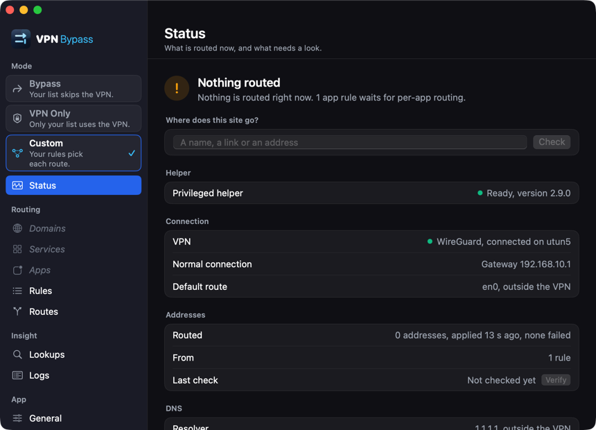
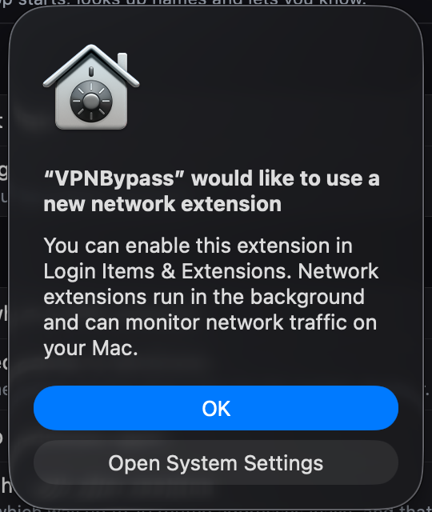
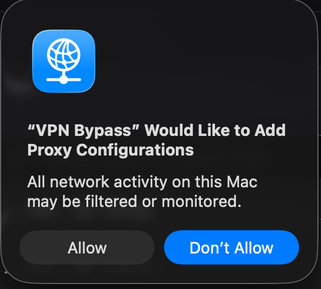
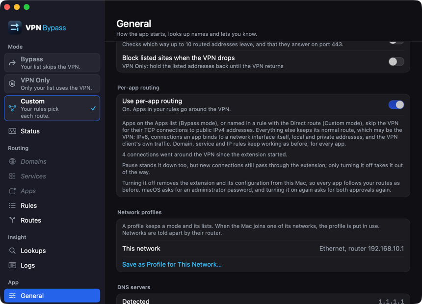
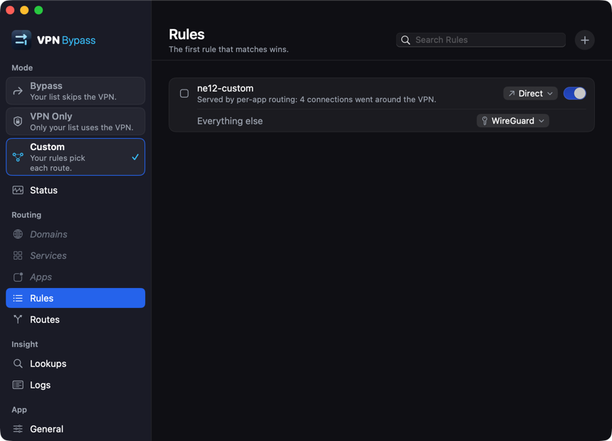
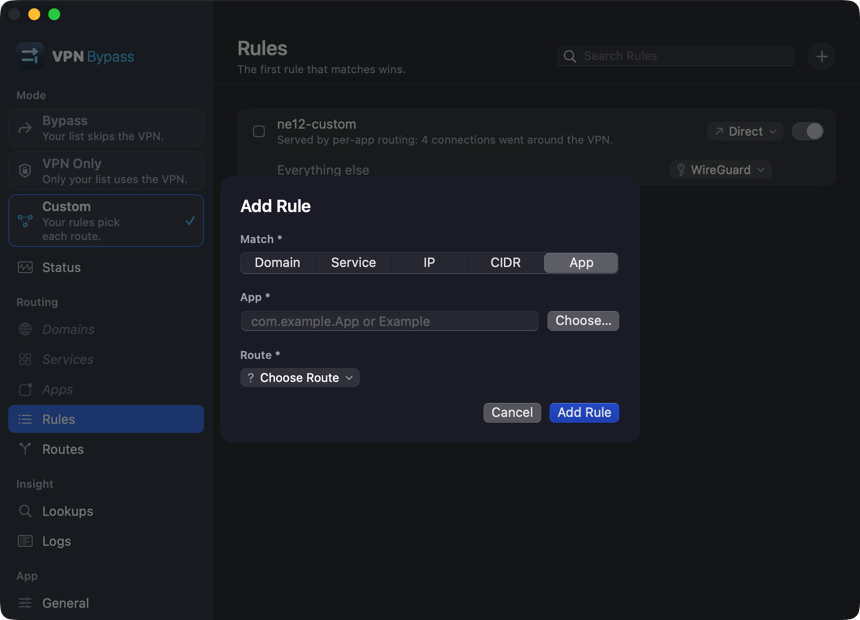
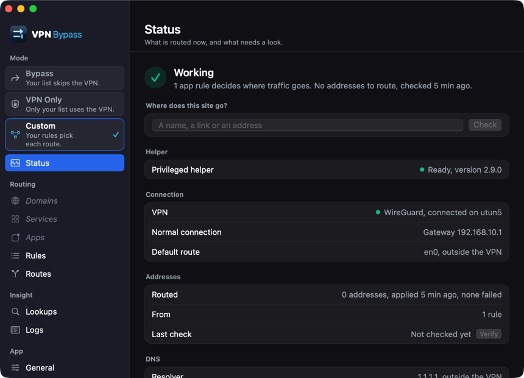
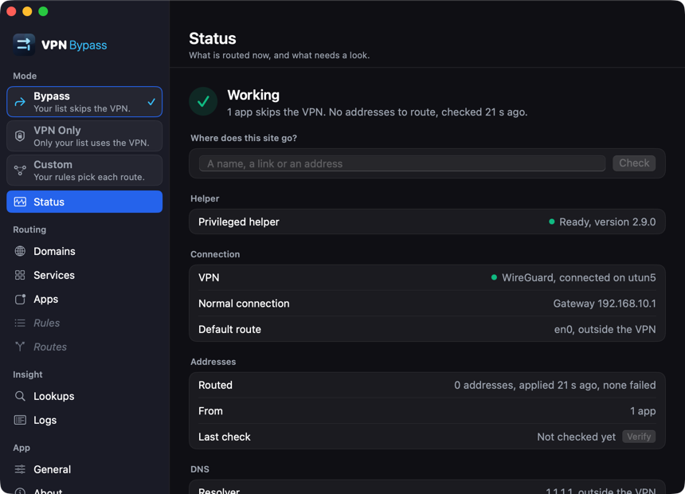
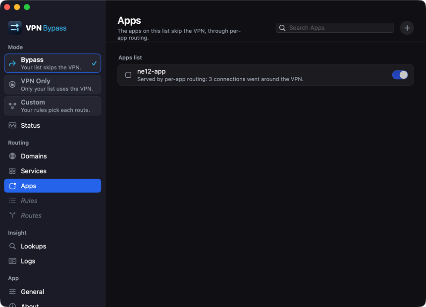
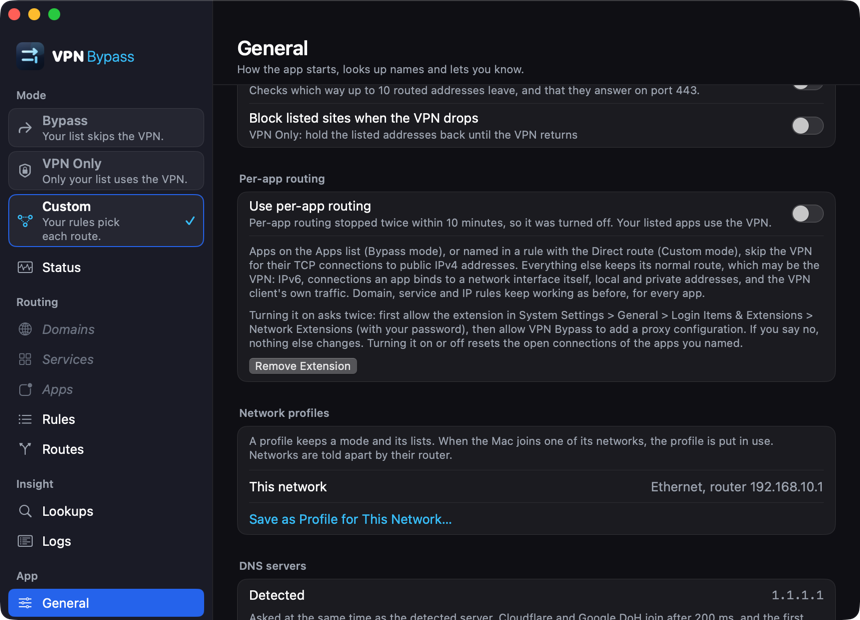
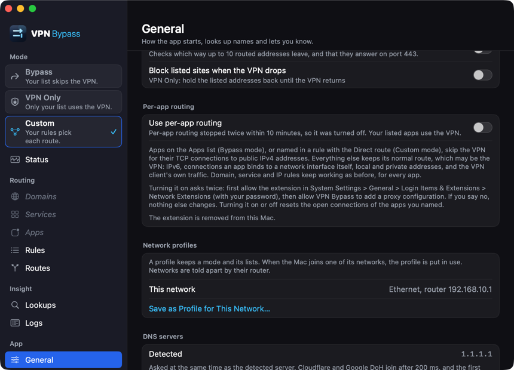

More shots in `docs/images/pr/ne-live-gates/`: the switch off (02), awaiting the extension (14), and
removed after `engine.off` (13). The System Settings sheets are not committed: they list other
products installed on the mini.

**Seen on the way, not fixed here:**

- The system alert's own "Open System Settings" button closed the alert without opening System
  Settings, twice. The app's own Open System Settings button opens Login Items & Extensions, from
  where the Network Extensions (i) sheet is one click.
- The alert names the app "VPNBypass" (the bundle name) although `CFBundleDisplayName` is set; System
  Settings uses "VPN Bypass".
- With the half tunnel up, Status says "Default route: en0, outside the VPN", while `0/1` and `128/1`
  send everything into `utun5`. That line is wrong for this kind of VPN.
- Right after the switch comes back on, the General group says "0 connections went around" until the
  next count arrives.

**Left for the owner's Mac:** L0 on macOS 27 (the alert and the sheet), L1 to L4 with GlobalProtect
and the AWS VPN Client, Remove and the Filters & Proxies path on macOS 27, the administrator password
prompt for each approval, L11 (restart and login) and the soak.

Cleanup: app quit; tunnels and the peer container removed; scutil keys gone; the mini's 5.1.4 app and
helper 2.3.1 back (sha256, modes and signature match, helper running); its settings, log and
`/etc/hosts` (sha256 and mode 0440) back; the authorization rule back to
`authenticate-admin-nonshared`; temporary keychain deleted, search list as it was, profiles and keys
deleted. Three 6.0.990 extension entries stay `terminated waiting to uninstall on reboot`; the mini
was not restarted.
