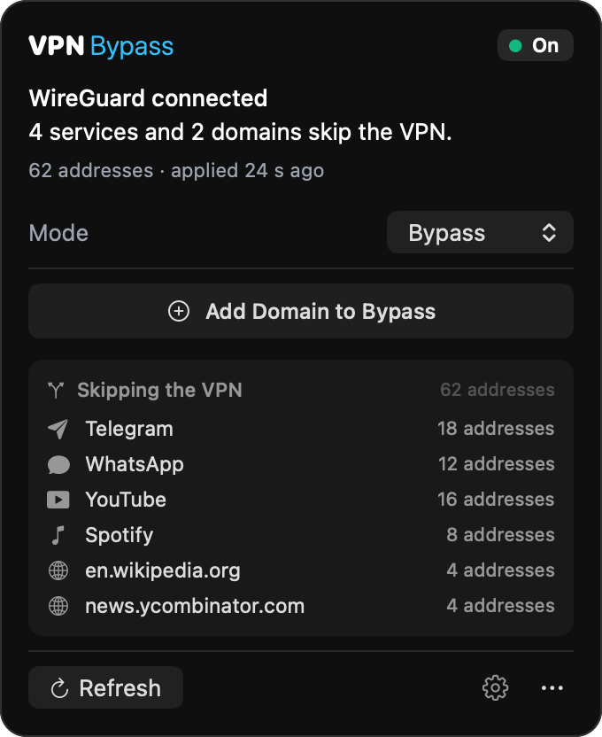
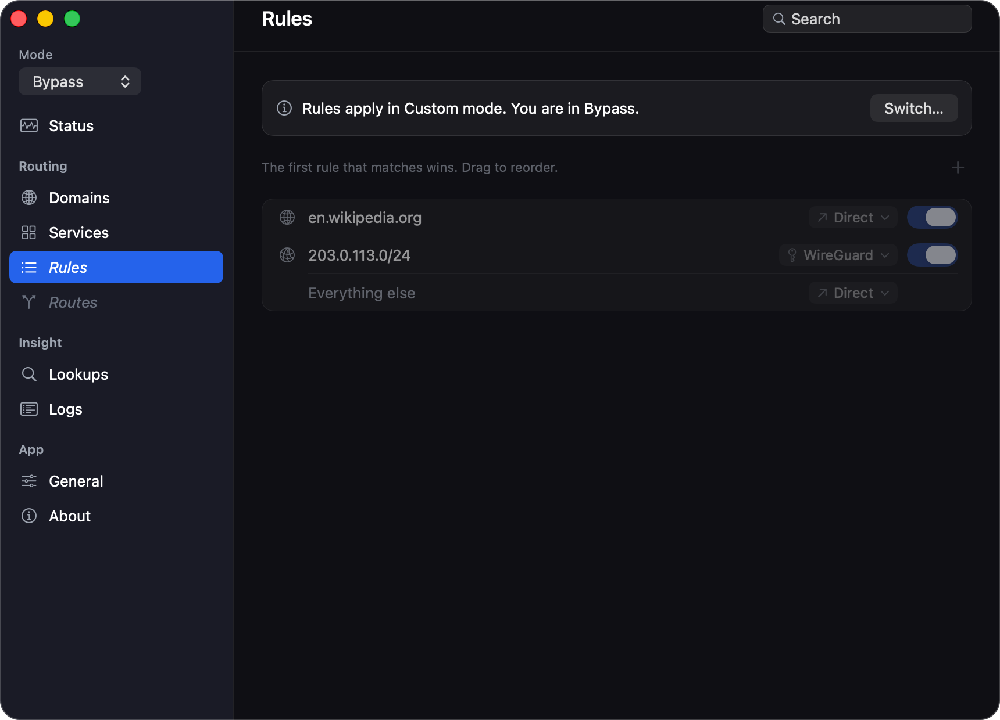
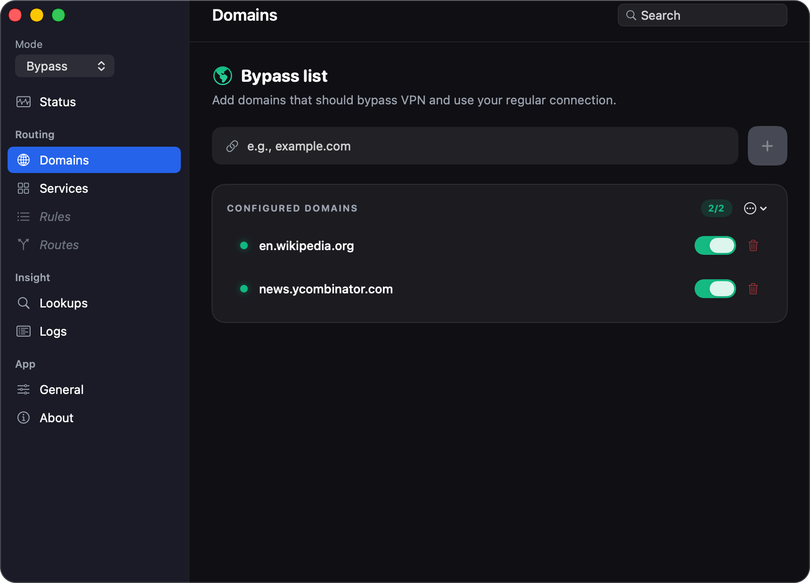
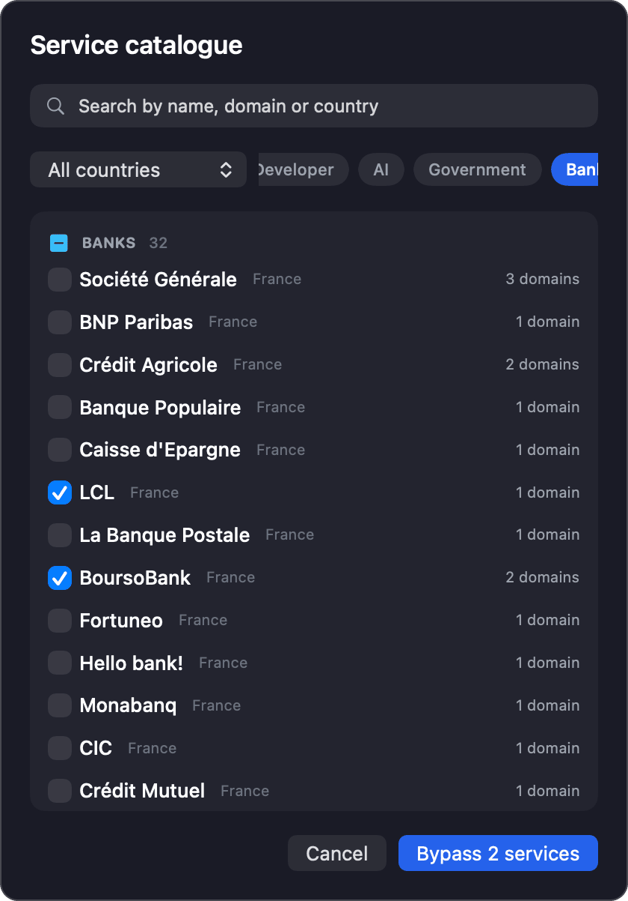

# Usage

Two words mean one thing each on screen. A **route** is a way out for traffic in Custom mode: Direct, your VPN, a proxy or a Tailscale peer. An **address** is one IP address or range the app has sent a certain way; a service such as Telegram is several of them.

## Menu bar

Click the VPN Bypass mark in the menu bar: two lines and a bar, with an arrow head on the top line while routes are enforced. The dropdown shows:

- a status chip next to the wordmark, the only coloured mark at the top: On, Waiting (the app waits for a reconnected tunnel to hold before it re-applies routes, or holds back after the tunnel dropped right after several applies), Partly routed (some of your list is routed and some failed or has no addresses), Not routing (nothing is routed, the helper is down, or the VPN's kill switch sends all traffic through it, so the routes change nothing; see [VPN kill switches](coexistence.md#vpn-kill-switches)) or Off (no VPN, or a fresh install with nothing configured), in grey, since neither is a fault;
- three lines under it: the VPN it found, one sentence on what your lists route, and a third line with the numbers, for example "62 addresses · applied 24 s ago · DNS again in 18 min". When something is wrong, the third line says what instead, with one button: with the helper down it says how many addresses from before are still routed, since a stopped helper leaves its routes in place, and says no address is routed only when none is left; Fix… opens Settings > Status, where the helper's Install button is; when part of an apply failed it gives the count, for example "62 addresses, 7 failed", and Show opens Settings > Status > Problems. Problems lists each address the system refused and each name that did not resolve, with the entry it was for and the reason, then the entries that route no address; Retry applies the routes again, or after a Remove All Routes that left some, removes them again. With no VPN it says what connecting does in the current mode. While the chip reads Waiting, it counts down to the apply;
- on a fresh install in Bypass mode, in place of everything down to the gear: the question "What should skip the VPN?", six common services with their switches, a row that opens Settings on the Services page, a field to add a site, and a line that offers VPN Only. Once a service is on or a site is on the list, the normal dropdown below takes its place at once;
- the Mode popup, with Bypass, VPN Only and Custom in every mode. Picking another mode asks first, and the selection moves only after you confirm. Entering Custom turns your lists into rules here too, when Custom has no rules yet and the current mode's list has an entry switched on, and the question says so only then, as the Settings sheet does;
- a field to add a domain to the current mode's list, open in every state, with no VPN and while the app starts too. Its placeholder says what it adds: "Add a site to bypass…", "Add a site for the VPN…", or "Add a Direct rule…". ⌘N puts the cursor in it, Return adds, and Esc empties it and leaves it; while routes are being applied it waits, as the Domains page does; with the field empty and unused, Esc closes the dropdown as before. After an add the field empties and a line under it says where the entry went. In Custom mode it adds a rule on the Direct route instead: an IP range such as `10.0.0.0/24` becomes a CIDR rule, and a name or a pasted link becomes a domain rule for its host. A value it cannot save stays in the field with a line under it that says why: a range with a prefix outside /2 to /32, or a value that already has a rule. When that rule is on another route, such as your VPN or a proxy, the line names the route, since the first matching rule wins and a Direct rule after it would do nothing;
- under the field, the site open in the browser you just left: "shop.example.com · open in Safari", with the field's add (Add to Bypass, Add to VPN Only, or Send Direct in Custom mode). A site already listed says where instead, as the Lookups page does. It reads the front tab of Safari, Safari Technology Preview, Chrome, Chromium, Brave, Edge, Vivaldi and Arc through Apple Events, and only when that browser was the app in front before the dropdown opened; Firefox cannot be read this way. The first time, the row offers Allow…, which brings up macOS's Automation prompt for that browser; once you say no, the row stays hidden until you allow it in System Settings > Privacy & Security > Automation. A blank page, a local page (localhost, a file) or an IPv6 address gives no row;
- what your lists route, one row per service, domain or IP range you added, with how many addresses it routes in one column under the word Addresses, under Skipping the VPN in Bypass or Through the VPN in VPN Only. Past eight rows the list scrolls. Hover over a row to see its addresses, and one button at its end: Turn Off for a row that routes, Retry for a row with a problem, which applies the routes again. Right-click a row for Turn Off, Retry, Show in Settings (its page, with the search set to the row) and Copy Addresses. A row that routes no address while no apply is running or waiting after a reconnect gets an amber mark, and under its name the reason: what the last apply said for it, such as "Did not resolve: no answer from DNS", or "No address is routed for it." In VPN Only the app's own catch-alls are one line, "Everything else: direct", and the counts leave them out: the card, the third line at the top, the Status page's Addresses section and the Addresses Routed notification all count only the addresses your lists route. Addresses owned under Tunnels on the Status page counts the kernel's routes that carry the app's tag by the same rule and names the catch-alls apart, as in "2, plus 4 catch-alls". With only the catch-alls in place, the chip still reads On, since everything else is routed direct. In Custom mode, Routes In Use comes first, then Routed by your rules lists the rules that routed an address. Addresses that no entry on your lists owns, such as those of an entry you just removed, are one "Left from earlier" line;
- Pause, with For 15 Minutes, For 1 Hour, Until the VPN Reconnects and Until I Resume. Pausing removes the app's routes, so traffic follows the VPN's own routes (a split-tunnel VPN still sends some destinations outside it), and the chip reads Paused, with "Paused: traffic follows the VPN's own routes." and, on the third line, when it ends ("Resumes at 14:32, in 58 min") and a Resume button. If some routes could not be removed, the block says how many are still in place, with Retry, and never says Paused. While paused nothing puts a route back: not auto-apply, the DNS refresh, a reconnect, a wildcard lookup, the add field or an edit on the Domains or Services pages; what you add or change is saved and applied when you resume. Resuming is one apply, the same as Refresh, and it waits as the apply after a reconnect does when the tunnel just came up or keeps dropping. Changing mode ends the pause, and so does turning on a proxy route or pointing a Custom rule anywhere but Direct. Quitting while paused leaves no route behind, and the app starts unpaused. Pause is greyed in VPN Only, where removing the routes would send the listed sites outside the VPN, and in Custom unless every enabled rule goes Direct; it is also greyed while a proxy or Tailscale route runs its local listener, which Pause would not stop. The menu's first line says why. The menu bar icon shows the paused glyph;
- Refresh, the gear that opens Settings, and a "…" menu with Verify Routes and Re-resolve DNS Now while a VPN is connected, then Open Logs, Quit VPN Bypass and Remove All Routes…, which asks before it removes anything. The gear and the "…" menu take a click anywhere in a 24 pt square around them;
- after Verify Routes, the result is a Route check card on Settings > Status, where Dismiss takes it away. Verify path-checks at most 10 of the routed addresses: single addresses only, because a range has no one address to connect to, and the first 10 in sort order. Each must leave the way its route points and answer on port 443, and a control address the app does not route must leave the other way, or every result reads "Check broken" (see [Path check](how-it-works.md#path-check)). The card says how many of how many addresses it checked, for example "Checked 10 of 62 addresses (single addresses only).", lists the addresses that did not answer first, up to three with what each is routed for and why it failed ("Went into utun4", "No answer on 443 via en0") and then "+ N more", then one line for the rest with their response times. "Show all 10 results in Logs" opens the Logs page, where each address has its own line. With only address ranges routed, the card says there was nothing the path check could test;
- after a change made through `vpnb` or an [MCP server](mcp-server.md), a line at the foot that names it, for example "Last change: added en.wikipedia.org via the command line, 2 min ago". Click it to open Logs showing only the lines that came through the control socket. A change you make in the app removes the line.

Each time you open the dropdown, the app checks the VPN again and puts back any route macOS dropped, so the dropdown shows the state as it is now. It also runs the same check every 30 seconds, whether the dropdown is open or not, and while an alert such as the mode switch question waits for an answer.

While the dropdown is open, ⌘N puts the cursor in the add field (on a fresh install, in the site field that stands in for it), ⌘, opens Settings and ⌘Q quits. ⌘P pauses for an hour, or resumes while paused; it does nothing while Pause is greyed. ⌘R refreshes routes only while the Refresh button is enabled, which is when a VPN is connected, the helper is ready and no route or DNS work is running; otherwise it does nothing. Holding ⌘R refreshes once. The "…" menu lists ⌘Q next to Quit, and the Refresh button's and the gear's tooltips name their shortcuts.

{ width="340" }

## Settings

Click the gear icon to open Settings. A sidebar lists every page in every mode: Status at the top, then Routing (Domains, Services, Rules, Routes), Insight (Lookups, Logs) and App (General, About). The window opens on the page you had open last, Status the first time, and the page name is the window's title. The window can be resized, down to 720 × 480.

Pages that belong to another mode stay in the sidebar, greyed and in italics, and open read-only with one line at the top, for example "Rules apply in Custom mode. You are in Bypass." Its Switch… button opens the mode sheet on that mode. Domains belongs to Bypass and VPN Only, Services to Bypass, and Rules and Routes to Custom. Switching mode keeps the page you are on; a page of the old mode turns read-only.

The routing mode is the popup at the top of the sidebar. Picking another mode in it opens a sheet that lists the three modes, each with one sentence and what your lists hold for it ("4 services and 2 domains"). For Custom it says "Your lists become rules." when the switch will build them, which happens when Custom has no rules yet and the current mode's list has an entry switched on. Otherwise it says how many rules Custom has. Nothing changes until you click Switch, and the popup keeps showing the mode in use until then.

On the list pages (Domains, Services, Rules, Routes and Lookups) a search field sits at the right of the title bar. It keeps the rows whose name contains what you type, ignoring case and accents, and ⌘F puts the cursor in it.

{ width="580" }

{ width="580" }

{ width="580" }

Domains: the list of the mode you are in comes first, the Bypass list in Bypass mode and the VPN Only list in VPN Only mode. Its first row adds a domain, a `*.wildcard` or, in VPN Only, an IP range: type it and press Return. Each row of that list has its switch, and delete appears when the pointer is on the row. Outside Custom mode, a row that is on shows how many addresses it routes, a wildcard the ones it has learned as you browse. The other mode's list follows, read-only, so you can see it without switching modes: its rows have no switch, no count and no delete, and an entry that is off says Off. The ⋯ menu above the list holds Turn All On and Turn All Off.

A domain that finds no address on three refreshes in a row while the VPN is up gets a warning sign and the line "Hasn't resolved since" with the day of the first failure. A refresh with the VPN down does not count, since an internal name resolves only through the VPN, and neither does a refresh that asked several names where none resolved. One answer clears it. While any entry is in that state, a "Not resolving" button above the list shows only those entries, so you can remove them.

Services: one line at the top says what the page is for, with the + that creates a custom service at its end. Under it, Your services lists the services that are on, then your custom services that are off. Each row says on its second line what the service holds ("6 domains · 8 IP ranges", "Custom · 2 domains"), then the addresses it routes in Bypass mode, then its switch. Each service bundles known domains and IP ranges. The app ships a catalogue of services (Telegram, YouTube, Spotify, French government sites, French banks, …), one file per category inside the app; nothing is downloaded. "Browse catalogue…", under the list, opens it: a search field (name, domain or country, so "France" finds the French government and every French bank), a chip per category, a checkbox per service and a select-all box per category. "Bypass 3 services" turns the picked ones on with one save and one batch of route writes, and they join the page. A service that is already on shows checked and greyed out, and one a custom service holds off by its name shows why. A search on the page that finds nothing offers "Search the catalogue" with the same text. A service an older version shipped and the catalogue no longer has stays on the page with your custom services when it is off, since the catalogue has no row for it. Switching a catalogue service off sends it back to the catalogue: it keeps its row, switch off, until you next open the page. A service you switch on or off keeps its place until then, so a row never moves from under the pointer. That holds for a newly created service too, and for a service switched through `vpnb` while the page is open. The ⋯ menu above the list holds Turn All On… and Turn All Off, and both re-sort the list at once. Turn All On covers the services on the page only, never the catalogue. It asks first when it would turn on more than five services ("Send 8 services around the VPN?"), with Cancel as the default button. Turn All Off does not ask.

{ width="580" }

The catalogue is a starting point, not a complete list. When a service needs a name it does not ship, add the name to it from the Lookups page, or make a custom service.

Custom services: the + button on the Services page creates one, with a name, its domains and optional IP ranges. The app tracks routes by name, so a custom service cannot take the name of another service, built-in or custom, or of a domain on the Bypass list. Case and spaces around the name do not count, so Netflix already has "netflix". When a name is taken, the editor outlines it in red, says which service or domain has it, and keeps Save off. Importing a configuration file with such a name imports nothing and names the service to rename in the file. A built-in service is the exception there: a file whose custom service has a built-in service's name imports, and the built-in one stays off, as below. The rule holds the other way too: the Bypass list refuses a domain that a service has as its name, from the Domains tab, from Undo and from `vpnb domain.add`. A configuration saved before this check still loads, with one change: a built-in service that one of its custom services has the name of is turned off. A custom service in it whose name is taken says so on its row's second line on the Services page, with an amber mark. Editing a service whose name is taken asks for a new name before it saves, and renaming or deleting it puts back the routes of the service or domain that had the same name. Services route only in Bypass mode, so in VPN Only or Custom mode deleting it leaves in place the routes of a VPN Only entry, the VPN Only catch-all or a rule with that name. An app update can add a built-in service whose name one of your custom services already has. Your custom service keeps its name, its switch and its routes, shows no red line, and its edits save. The built-in service stays off, and in the catalogue its box stays greyed out with a line that names your custom service, until you rename it.

VoiceOver: every switch, in the dropdown and on every Settings page, carries its row's name, such as Telegram or en.wikipedia.org, so a list of services is no longer a column of identical switches. Icon-only buttons say what they do and to which row, such as "Delete en.wikipedia.org" or "Edit Work Tools". Each dropdown row is read as one element, such as "Telegram, 18 addresses", and its actions (Turn Off Telegram, Show Telegram in Settings, Copy the Addresses of Telegram) are in the VoiceOver actions rotor. In the Settings sidebar, once it has the focus (click a page, or Tab with full keyboard access), ↑ and ↓ move from page to page.

If the menu bar icon cannot be seen, because it is switched off in System Settings > Menu Bar or the notch hides it, open VPN Bypass again from Finder, Spotlight or Launchpad: Settings opens on Status, which says the icon is not visible, with a button that opens the Menu Bar settings. With the Settings window already open, opening the app again only brings it to the front.

Undo: Delete removes a domain, a custom service with all its domains, a rule or a route on the first click, and leaves a line in the list such as "Removed news.ycombinator.com." with an Undo button. Turn All On and Turn All Off leave one too ("Turned off 4 services."). Undo, or Edit > Undo (⌘Z), puts the entry back where it was, with its switch as it was, and its addresses are routed again. Undoing Turn All On or Turn All Off switches back only the entries it switched. While routes are still being applied, Undo is greyed out like the switches, and ⌘Z waits up to 10 seconds; if they are still running then, the change stays on the line to undo later. The line covers the last change only: the next delete or Turn All On/Off replaces it, and switching page or mode, or closing Settings, drops it. Each of these also cancels a ⌘Z still waiting for routes, which then changes nothing.

Rules (Custom mode): the ordered rule list, first match wins. Each row shows what it matches (a globe for a domain or a `*.wildcard`, a grid for a service, a network glyph for an IP or a range), then its route chip and its switch. The chip opens the routes to pick from and New Route…. Edit and delete appear when the pointer is on the row, and are in its right-click menu. A rule on a proxy or Tailscale-peer route says on its second line that only apps set to use that route go this way, or that the rule does nothing while the route is off. Drag a row to move it. The last row, Everything else, picks the route for traffic no rule matches.

Routes (Custom mode): Direct and the detected VPN under Always there, then Your routes, the proxy, Tailscale-peer and pinned VPN routes you add with +. Each proxy or Tailscale-peer route shows on one line the local address apps point at and where it goes, then its type and its switch. With the pointer on it: Copy Proxy URL, edit, and ⋯ with Copy Shell Exports, Duplicate and Delete. A pinned VPN route has no local address: its line shows only the tunnel it uses, and the pointer brings edit and ⋯ with Duplicate and Delete. After a copy, the line under the list says what was copied. After Copy Proxy URL it also says how a browser signs in: the user is vpnb, and the password is the part between `vpnb:` and `@` in the URL.

Status: whether the app is working right now, on one page. A line at the top gives the verdict ("Working", "Not working", "No effect" under a VPN kill switch, "No VPN connected") and the same sentence as the dropdown, for example "4 services and 2 domains skip the VPN. 62 addresses routed 23 s ago, none failed." Under it:

- Helper: the privileged helper's state and version. When it is not ready, its box turns red and the row has an Install, Update or Retry button. This is the page the dropdown's Fix… button opens.
- Connection: the VPN and its interface, the normal connection (Wi-Fi network and gateway), and which interface carries the default route.
- Addresses: what the last apply routed ("62 addresses, 23 s ago, none failed"), what they come from ("4 services, 2 domains"), and the last Verify Routes ("10 of 62 checked, all reachable, 4 min ago"), with a Verify button. While a check runs, whether it started from this button, from the dropdown or after an apply, the row reads "Checking now…" with a spinner beside a greyed-out Verify.
- DNS: the resolver used outside the VPN, when DNS was last refreshed and when it is next due, with Refresh Now.
- Tunnels: every tunnel that is up, each with one sentence ("The app acts on this one. It carries the default route.", "Never touched." for Tailscale), the Act on menu that pins one tunnel, and Addresses owned, how many kernel entries carry the app's tag. In VPN Only the catch-alls are counted apart ("2, plus 4 catch-alls"), so the first number matches Routed while the kernel holds what the app installed; in Bypass and Custom it is one number. The tunnels are read when the page opens, when the VPN changes, and on Refresh.
- Recent warnings: the three newest warnings and errors. Show in Log opens Logs with Warnings selected.

Lookups: the names this Mac looks up, most frequent first, for when you do not know what to add. It is off until you click Start Watching; Stop Watching, beside the line at the top of the page, turns it off again. Then the helper runs `tcpdump` to read the DNS questions the Mac sends on every interface, the VPN included. It never reads the answers, questions other devices send to this Mac, or any other traffic, and it never puts an interface in promiscuous mode. A name counts once per 3 seconds, so the A, AAAA and HTTPS questions a browser sends for one visit are one lookup. The title bar search (⌘F) filters the list and Clear starts the count again. Each row is the name, then its count at the right end, in a column as wide as the biggest count. A row the mode does not route yet is one line with a globe. Point at the row and its add button appears, saying what it does in the current mode in its tooltip and spoken name: Add to Bypass, Add to VPN Only, or Send Direct (a rule to Direct in Custom mode). The row's right-click menu holds the same actions. When a service that is off lists the exact name, built-in or custom, the button reads Turn on and the service's name (a power glyph), and turns that service on, unless a custom service holds a built-in one off by its name; then the line under the search says why and nothing changes.

The ⋯ beside the button (More ways to add) opens the add panel, anchored to the row. What to add: the exact name, chosen by default, or a wildcard over it at any level, so api.us5.datadoghq.com offers `*.us5.datadoghq.com` and `*.datadoghq.com`. The widest is the site's own domain: never `*.com`, and three labels under a country suffix such as co.uk or com.au (`*.bbc.co.uk`, never `*.co.uk`). A wildcard covers every name under it, routed by the helper as each one is looked up, so the page does not have to keep watching. How that works, and its limits: [research/wildcards-and-network-extension.md](research/wildcards-and-network-extension.md). Where: in Bypass mode, the Bypass list, New Service…, which makes a custom service with the choice as its first domain, or any service, built-in or custom, with a search field. Services that are off are marked off, and the ones that already hold a name under the same site domain come first. A name added to a catalogue service that is off waits there until you add the service from Browse catalogue. Eight services show at once; a longer list scrolls inside its box. In VPN Only mode the panel offers the VPN Only list only, since services route only in Bypass mode. In Custom mode it adds a rule to Direct: a domain rule for the exact name, a suffix rule for a wildcard. Add saves the choice (Return), Cancel or Escape closes the panel.

A name added to a built-in service is kept apart from the service's shipped domains, so it survives restarts, app updates, and switching the service off and back on from the catalogue. The Services page lists it on the service's second line as Added. Point at the row (or use its right-click menu or VoiceOver actions) to remove it: Remove and the name, or ⋯ with one Remove per name when there are several; the shipped domains cannot be removed.

A name the mode already routes has a check glyph and says so on its second line: Bypassed, with the service's name when a service has it (Bypassed · Meetings), Via VPN, or the route its rule sends it to. A wildcard counts: with `*.datadoghq.com` on the Bypass list, every name under it reads Bypassed. Point at the row and a button appears that takes the name back out, through the same path as the Domains, Services or Rules page, so its routes go too:

| Where the name is listed | The button | What it does |
|---|---|---|
| The name itself on the Bypass or VPN Only list | Remove | Takes the entry off the list |
| A wildcard on the list that covers it | Remove `*.example.com` | Takes the wildcard off; names under it stop unless another entry lists them |
| The name in a custom service, or added to a built-in one | Remove from Service | Takes only that domain out of the service |
| A wildcard in such a service | Remove `*.example.com` from Service | Takes the wildcard out of the service |
| A domain a built-in service ships with | Turn off Service | Turns the service off, which stops all of its names |
| A Custom mode rule to Direct | Remove, or Remove `*.example.com` for a suffix rule | Deletes the rule in force, as the Rules page does |

The name's own entry comes off before a wildcard over it, and the list before a service. When another entry still lists the name after a remove, the line under the search says so, and pointing at the row again offers to remove that one. A Custom mode rule that sends the name to the VPN or a proxy has no button; change it on the Rules page. A name whose entry is switched off reads Off, with a pause glyph, and has no button; switch it on or remove it on the Domains page. The buttons wait while routes are being applied. The list lives in memory only and is cleared when you stop watching or quit; a name you only see here is never written to the log or to disk. A name you Add is saved and logged like any name you type in by hand. Whether the page is watching is saved, so the capture resumes when the app restarts. If the app stops asking for a minute, the helper stops `tcpdump` by itself.

Lookups a browser sends over encrypted DNS (Secure DNS, DNS over HTTPS) go out as HTTPS and never show here. To see them, turn Secure DNS off in the browser's settings while you look. Plain DNS sent over TCP does not show either, because the capture reads UDP port 53 only; macOS uses TCP for a lookup only when a UDP answer comes back too large to fit.

{ width="580" }

{ width="340" }

General: settings only. Launch at login, auto-apply on connect, `/etc/hosts` management, route verification, the DNS refresh schedule, fallback DNS, notification preferences, the SOCKS5 proxy, and import/export.

Block Listed Sites When the VPN Drops, under Behavior, is off by default and acts in VPN Only mode. Without it, a VPN drop takes the routes into the VPN away and the listed sites load over your normal connection. With it on, the helper puts a block (a reject route) on each listed address the app resolved, so a connection to it fails at once, and the dropdown says "VPN down: listed addresses blocked for N site(s)" with Open them directly, which takes the blocks away until the next drop. Disabling or removing an entry takes its blocks away too. When the VPN returns, the apply that puts the routes back replaces the blocks; while that apply waits for the tunnel to settle the line reads "Waiting for VPN routes". Leaving VPN Only, turning the setting off, removing all routes and quitting take the blocks away, and a block left by a crash goes at the next start. It blocks the IPv4 addresses the app resolved and the IPv4 ranges on the list, nothing else: an IPv6 address or a lookup that skips the system resolver (browser DoH) still reaches a listed site, and a launch with the VPN already down blocks nothing, since there was no drop.

Logs: the last 200 log entries, newest first. The segmented control above the list shows All, Warnings (warnings and errors) or Errors, and the search field keeps the entries whose text contains what you type, ignoring case and accents, with the match marked. A line above the list says how many entries match, for example "3 of 200 entries". Copy copies only the entries shown. Clear removes every entry, including the ones the filter hides. A line written while the app served a request on the control socket, from `vpnb` or an MCP server, ends in "via the command line", and so do the lines of the work that request started. The dropdown's "Last change" line opens the page with a "From the command line" token that shows only those lines; click the token to show every line again.

About: version and helper status.

## Command-line control (`vpnb`)

A bundled `vpnb` CLI drives the same routing the GUI does, over a user-only UNIX socket, for scripting or a headless Mac. It needs no extra privilege (the app already holds it).

`vpnb` ships inside the app bundle (`VPN Bypass.app/Contents/MacOS/vpnb`). Installing via the Homebrew **tap** (`brew tap geiserx/vpn-bypass && brew install --cask vpn-bypass`) symlinks it onto your `PATH`. With a manual DMG install, call it by its full path (`"/Applications/VPN Bypass.app/Contents/MacOS/vpnb"`) or symlink it onto your `PATH` yourself.

```bash
vpnb status                                   # current mode, routes, schema/version
vpnb mode mode=custom                         # switch modes: bypass | vpnOnly | custom
vpnb route.add name=work type=socks5 host=127.0.0.1 port=1080
vpnb rule.add match=suffix pattern=example.com routeId=<uuid>
vpnb route.list ; vpnb rule.list
```

Secrets are never passed on the command line (argv is world-visible via `ps`). Pass the bare token `pass:-` and pipe the password on stdin:

```bash
read -rs PASS && printf '%s' "$PASS" | vpnb route.set id=<uuid> pass:-
```

Set `VPNB_SOCKET` to override the socket path (default: `~/Library/Application Support/VPNBypass/control.sock`).

### Domains, services and logs (4.9.0 and later)

From VPN Bypass 4.9.0, `vpnb` also reaches the Bypass and VPN Only modes: the two domain lists, the services, the routes the app has installed, the refresh buttons and the log.

```bash
vpnb domain.list
vpnb domain.add domain=example.com
vpnb domain.add domain=10.0.0.0/8 list=vpnOnly
vpnb domain.disable domain=example.com
vpnb domain.enable domain=example.com
vpnb domain.rm domain=example.com
vpnb service.list
vpnb service.list id=netflix
vpnb service.enable id=netflix
vpnb routes.active
vpnb routes.clear
vpnb refresh
vpnb dns.refresh
vpnb logs limit=20 level=error
```

- `domain.list` shows both lists, the Bypass list first; `list=bypass` or `list=vpnOnly` shows one. The VPN Only list also takes a CIDR.
- `domain.add` adds to the Bypass list unless you pass `list=vpnOnly`. It cleans and checks the value the way the Domains tab does. The Bypass list refuses an IP range such as `10.0.0.0/24` and takes a pasted link as its host name, and the VPN Only list refuses a malformed CIDR and a `/0` or `/1`. Adding a domain that is already on the list, or one that a service has as its name, returns `already_exists`.
- `domain.rm`, `domain.enable` and `domain.disable` take `domain=` or `id=<uuid>`, and look in both lists unless you pass `list=`. They read `domain=` by the same rule as `domain.add`, so a value that added an entry also finds it: on the Bypass list `https://example.com/page` and `example.com/page` find `example.com`, and with `list=vpnOnly` a value with a `/` must be a CIDR such as `10.0.0.0/8`. Without `list=`, a link is looked up on both lists by its host. A malformed range such as `10.0.0.0/33` returns `invalid_args`. When the same domain is on both lists, pass `list=bypass` or `list=vpnOnly`.
- `service.list` lists every catalogue service with its switch, plus your custom services. `service.list id=netflix` shows one service with its domains and IP ranges. `service.enable` on a catalogue service adds it to the Services page; `service.disable` turns a service off and sends a catalogue service back to the catalogue. `service.enable` returns `already_exists` for a built-in service that one of your custom services has the name of; rename the custom service first.
- Enabling something that is already on, or disabling something already off, succeeds and changes nothing.
- A domain or service change is saved before `vpnb` returns. The routes for that entry are added or removed a moment later, and only while a VPN is connected and the app is in the mode that uses that list: Bypass mode for the Bypass list and the services, VPN Only mode for the VPN Only list. Run `vpnb routes.active` or `vpnb logs` to see them.
- `routes.active` lists the routes the app has installed; `source=<domain or service name>` keeps one source. `routes.clear` is Remove All Routes… in the dropdown's "…" menu, without the question, and the routes it removes come back at the next refresh, VPN reconnect or DNS refresh.
- `refresh` is the Refresh Routes button and `dns.refresh` is Settings > Status > Refresh Now. Both start the work and return at once. `refresh` fails with `helper_not_ready` when the privileged helper is not ready.
- `vpnb status` prints the running app's version as `app: <version>` (the `appVersion` field on the socket).
- `logs` prints the newest entries first. It takes `limit` from 1 to 200 (default 50) and `level` as `info`, `success`, `warning` or `error`.
- An app older than 4.9.0 answers these commands with `unknown_command`.

### JSON output

Add `--json` anywhere on the line and `vpnb` prints the app's reply as one line of JSON instead of text, for every command. A script can then read it with `jq` rather than parse the text, which may change between versions.

```bash
vpnb --json status
```

```json
{"ok":true,"result":{"defaultRouteId":"6F1C2E4A-8B3D-4F5E-9A7C-1D2E3F4A5B6C","mode":"bypass","routes":[{"egress":"vpnDefault","enabled":true,"hasPassword":false,"hasProxyUser":false,"id":"6F1C2E4A-8B3D-4F5E-9A7C-1D2E3F4A5B6C","name":"Corporate VPN"},{"egress":"direct","enabled":true,"hasPassword":false,"hasProxyUser":false,"id":"0A9B8C7D-6E5F-4A3B-8C2D-1E0F9A8B7C6D","name":"Direct"}],"runtime":{"appVersion":"5.2.0","enforcedRouteCount":3,"enforcing":true,"helperReady":true,"helperState":"Helper Installed","vpnConnected":true,"vpnInterface":"utun4","vpnType":"WireGuard"},"schemaVersion":1,"supportedVersion":1},"v":1}
```

```bash
vpnb routes.active --json
```

```json
{"ok":true,"result":{"activeRoutes":[{"destination":"93.184.216.34","gateway":"192.168.1.1","source":"example.com"},{"destination":"203.0.113.0/24","gateway":"192.168.1.1","source":"Example Service"}]},"v":1}
```

```bash
vpnb routes.active --json | jq -r '.result.activeRoutes[] | "\(.destination) \(.source)"'
```

```
93.184.216.34 example.com
203.0.113.0/24 Example Service
```

- Keys are sorted, and a field that does not apply is left out rather than set to `null`. `status` lists under `routes` the route table that Custom mode's rules point at; normally it holds at least the VPN and Direct routes, which the app adds when the list is empty, but `route.rm` can remove either, so a script should not assume them. `defaultRouteId` names the route unmatched traffic takes. `runtime.helperState` is display text in the app's language; test `helperReady` and `enforcing` instead. Every reply has `v` and `ok`, then `result` on success or `error` (`code` and `message`) on failure.
- Exit codes stay the same: 0 ok, 1 the app answered with an error, 2 the app could not be reached. On exit 2 the message still goes to stderr, and stdout carries an error object too, with the code `app_unreachable`, `no_response` or `no_stdin`, so a script always gets one JSON object to read.
- No password or proxy user name is ever in the reply. A route says `hasPassword` and `hasProxyUser` instead.
- In `routes.active`, `source` is the list entry, service or rule the route was installed for, not an application: see [Which app uses a route](how-it-works.md#which-app-uses-a-route). [Routing priority](how-it-works.md#routing-priority) explains how these routes win over the VPN's and how to spot them in `netstat -rn`.
- `help` and a bare `vpnb` still print the help text.

### Where does this site go? (`vpnb why`)

`vpnb why <host>` takes a name, a link or an address and says which entry decides its way, then path-checks it. It works in every mode and changes nothing.

```bash
vpnb why example.org
vpnb why https://en.wikipedia.org/wiki/VPN --json
```

The host is resolved as the macOS resolver answers it (what a browser connects to, hosts file and wildcards included) and as the app resolves its list. Then, in order: an installed route for one of its addresses, named by its `source`; a listed wildcard that covers it; in Custom mode the rules, first match by order, name and address rules alike, then the default route; a list entry with no route yet; nothing. Up to 4 addresses are checked as in [Path check](how-it-works.md#path-check), with the same control. The text reply is one or two sentences, a line per address and one for the control, then the facts:

```
example.org is not on your list, so it follows the VPN. The check saw it leave through utun4, and it answered on port 443.
  203.0.113.7  via utun4 from 10.8.0.2  443: connected in 24 ms  ok
  control 192.0.2.1  via utun4 from 10.8.0.2
  match: none  expected: tunnel:utun4  verdict: ok
```

With `--json`, `result.why` holds `match` (`route`, `wildcard`, `rule`, `defaultRoute`, `listed`, `none`, `unresolved`), `entry`, `expected` (`physical` or `tunnel:<interface>`, absent for a proxy or exit node, which the routing table does not decide), `checks` (`interface`, `sourceAddress`, `answer`, `latencyMs`, and `verdict`, left out when the control is broken), `control` (the same fields without `verdict`, absent when no control ran), `verdict` (`ok`, `noAnswer`, `wrongWay`, `unknown`, `checkBroken`, `notChecked`, `noVPN`, `unresolved`), the `summary` sentence in the app's language, and `canAdd` when nothing lists it.

The [MCP server](mcp-server.md) uses the same socket, so an AI agent can do all of this too.

### Pause and resume (`vpnb pause`)

```bash
vpnb pause 15m        # or 1h, any length up to 24h, or reconnect
vpnb pause            # until vpnb resume
vpnb resume
```

`vpnb pause` does what the dropdown's Pause does and is refused the same way, with code `pause_refused` and the reason (in VPN Only, say). While paused, `refresh` and `dns.refresh` answer with code `paused`, and `vpnb status` adds `paused: until 2026-10-31T14:32:00Z` (or `until the VPN reconnects`, `until resumed`), `runtime.paused` with `--json`.

## Shortcuts actions

The Shortcuts app lists six VPN Bypass actions:

| Action | Does what `vpnb` does with |
|---|---|
| Set Routing Mode | `vpnb mode mode=<bypass\|vpnOnly\|custom>` |
| Add Domain | `vpnb domain.add domain=<name>`, with `list=vpnOnly` for the VPN Only list |
| Turn Service On or Off | `vpnb service.enable id=<id>` or `service.disable`, picking the service by name |
| Get Status | `vpnb status`: returns a line such as "Bypass mode. Routed addresses: 62" |
| Pause Routing | `vpnb pause`, with the dropdown's four lengths |
| Resume Routing | `vpnb resume` |

Each action runs in the app, through the same code as `vpnb`, so it gets the same checks and the same errors: a refused add stops the shortcut with the reason `vpnb` prints. A change shows in the dropdown footer as "Last change: … via Shortcuts", and its log lines carry "via Shortcuts"; a click on the footer line opens Logs showing only those lines.

Shortcuts' own automations (a Focus turning on, a time of day, joining a Wi-Fi network) can run these actions; which of those triggers a Mac runs depends on the macOS version.
